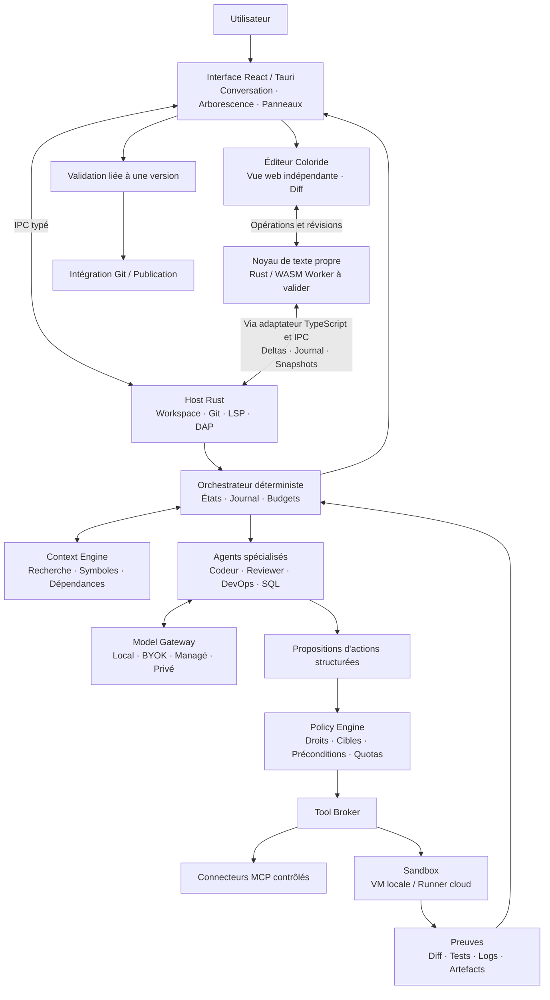
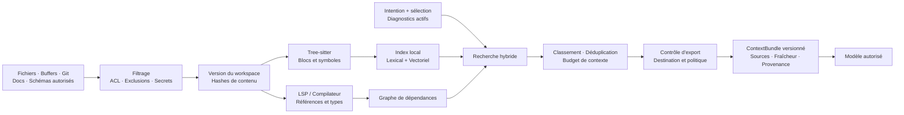

# Coloride — Dossier d’architecture et plan de développement

## 1. Vision produit et adaptation aux cinq personas

### Synthèse et décisions de cadrage

**Coloride sera un environnement de réalisation logicielle où chaque action proposée par une IA reste soumise à un contrôle déterministe, une exécution isolée et des preuves vérifiables.**

Le plan s’appuie sur les douze pages de l’étude [Stratégie IDE IA Next-Gen.pdf](</Users/ilyesameraoui/Downloads/Stratégie IDE IA Next-Gen.pdf>).

Les choix confirmés sont les suivants :

- **MVP destiné d’abord aux développeurs**, centré sur TypeScript et React.
- **Mode local/BYOK et cloud managé disponibles dès le MVP.**
- **macOS, Windows et Linux disponibles dès le MVP.**
- **Deux fondateurs au départ**, puis recrutements avant la première sortie.
- **Éditeur de code propre à Coloride, sans Monaco**, intégré dans l’interface React/Tauri existante dans l’architecture cible ; le chat, l’arborescence et les panneaux restent web.
- Couverture complète des cinq personas en V1.
- Nouveau socle applicatif : le dépôt actuel contient des documents stratégiques, sans implémentation à reprendre.

**Décision actualisée le 8 novembre 2026 :** le choix d’un éditeur propre remplace l’intégration de Monaco proposée initialement. Le fonctionnement interne détaillé de cet éditeur reste une proposition à valider par prototype ; aucune application ni mesure de performance n’est encore livrée. Les anciennes estimations calendaires fondées sur Monaco sont remplacées par les jalons de la section 4.

L’étude fournit une direction pertinente : cockpit d’agents, contexte local, isolation et budgets. Quatre propositions doivent être corrigées avant leur traduction technique :

| Proposition de l’étude | Décision d’architecture |
|---|---|
| Rust garantirait un démarrage inférieur à 100 ms et moins de 150 Mo de RAM | Remplacer ces promesses par des objectifs mesurés sur l’application complète, avec périmètre et matériel documentés. |
| MCP assurerait l’isolation et l’abstraction des modèles | Séparer connecteurs MCP, adaptateurs de modèles, autorisations et isolation d’exécution. MCP organise les échanges avec les outils et les ressources. |
| WASM permettrait une compatibilité légère avec les extensions VS Code | Exclure l’émulation générale du programme initial. L’emploi éventuel de WASM pour notre moteur de texte ne fournit pas les API et services attendus par les extensions VS Code. |
| Local-first et BYOK supprimeraient les risques et les coûts | Mesurer les transferts réels et les coûts d’exploitation ; BYOK transfère le coût d’inférence à l’utilisateur sans supprimer les autres charges. |

Ces distinctions suivent les périmètres documentés de [MCP](https://modelcontextprotocol.io/docs/learn/architecture) et de [Monaco](https://github.com/microsoft/monaco-editor).

### Matrice d’adaptation UX/UI

Un même workspace alimente trois présentations : **Créer**, **Apprendre** et **Développer**. Les espaces **Infrastructure** et **Données** ajoutent des outils spécialisés.

| Persona | Interface et parcours | Adaptation architecturale | Contrôle utilisateur |
|---|---|---|---|
| **Grand public / No-Code** | Conversation, sélection visuelle, aperçu, historique compréhensible, bouton Publier | Templates React et catalogue de composants ; édition visuelle transformée en modifications de code ; exécution et hébergement managés | Valider le résultat visuel, connaître le coût, revenir à une version publiée |
| **Développeur débutant** | Éditeur accompagné d’explications, diagnostics contextualisés, corrections guidées | LSP pour les erreurs ; agent pédagogique recevant diagnostic, code pertinent et résultat des tests | Comprendre une correction avant application ; afficher progressivement diff, terminal et debugger |
| **Développeur senior** | Éditeur Coloride, arborescence complète, navigation, diff multi-fichiers, terminal, debugger, supervision des tâches | Graphe du projet, conventions versionnées, workspaces isolés, agents parallèles à partir de la V1 | Définir périmètre, budget, politique d’autonomie et critères de validation |
| **Ingénieur DevOps** | Plans d’infrastructure, pipelines, inventaire, incidents et journaux corrélés | Connecteurs Terraform, Ansible, GitHub Actions et Kubernetes ; identités temporaires ; exécuteur de déploiement séparé | Examiner la cible et le plan exact avant toute modification de production |
| **DBA** | Schémas, SQL, plans d’exécution, comparaison de performances et migrations | Connecteur PostgreSQL, statistiques, clones assainis et exécuteur de migrations | Accès en lecture par défaut ; contrôle des verrous, sauvegardes et changements destructifs |

**Adaptation progressive :**

- Le profil initial est choisi explicitement et reste modifiable par workspace.
- Des suggestions facultatives proposent davantage de détails selon les fonctions utilisées.
- Aucun panneau ne disparaît automatiquement pendant une tâche.
- L’arborescence reste disponible dans tous les modes ; elle est affichée par défaut dans le mode Développer et accessible à la demande dans le parcours grand public.
- Le niveau d’expertise ne modifie jamais les permissions.
- Les composants visuels s’appuient sur des identifiants stables et des transformations AST. Un composant arbitraire non reconnu reste éditable en code et visible dans l’aperçu.

Le code demeure la source de vérité. Le produit ne promet pas une conversion visuelle universelle de tout programme.

L’identité Coloride associe couleurs, icônes et libellés : **tests réussis**, **à examiner**, **échec**, **source inchangée**, **non testé**, **validation périmée**. Un statut vert indique précisément les vérifications réussies sur une version donnée.

## 2. Architecture globale, Context Engine et exécution

### Organisation du système

Le MVP adopte un **monolithe modulaire Rust côté host**, avec des processus séparés pour les composants coûteux ou exposés : indexation, modèles locaux, serveurs de langage et sandboxes. L’interface reste React/Tauri. La vue de l’éditeur possède un cycle de mise à jour indépendant des panneaux React ; le prototype évaluera un noyau de texte Rust compilé en WebAssembly dans un Web Worker.

**Principe central : le modèle propose ; le système autorise et exécute.** Aucun texte généré ne devient directement une commande privilégiée.

### Core Editor Engine

| Composant | Responsabilité et choix |
|---|---|
| Workspace Service | Fichiers, réplica journalisé des buffers non enregistrés, sauvegarde atomique, surveillance des changements, récupération après crash |
| Git Service | Instantanés, branches de tâches, diffs et application conditionnée à la version courante ; conservation des modifications utilisateur |
| Editor Core Coloride | Noyau de texte propre en Rust : transactions, sélection, historique undo/redo et révisions ; exécution WASM dans un Worker proposée pour le prototype |
| Editor View Coloride | Vue TypeScript/DOM virtualisée indépendante de React : saisie, curseur, sélection, défilement, coloration, diagnostics et complétion ; intégration clavier, IME et accessibilité |
| Diff Service / Review View | Calcul des différences sur des snapshots immuables et vue de revue propre ; acceptation de modifications avec contrôle des versions, sans dépendance au diff de Monaco |
| Language Service | `typescript-language-server` au MVP ; LSP sur JSON-RPC/stdio, supervisé par le host |
| Debug Service | DAP avec adaptateur JavaScript ; lancement, évaluation et terminal soumis aux permissions |
| Terminal Service | `xterm.js` et PTY supervisé ; commandes des agents exécutées dans la sandbox |
| Preview Service | Origine distincte, sans pont IPC Tauri ni cookies du service de gestion |

Tree-sitter produit une structure syntaxique incrémentale ; les informations sémantiques viennent du LSP et des compilateurs. Un lien de dépendance déduit heuristiquement porte un niveau de confiance. [Documentation Tree-sitter](https://tree-sitter.github.io/tree-sitter/).

Les dépôts non approuvés ne peuvent pas déclencher librement hooks Git, scripts de démarrage, extensions ou processus de langage sur l’hôte.

### Éditeur propre dans React/Tauri

**Périmètre confirmé :** Coloride développe son moteur d’édition et sa vue, tout en conservant React pour le chat, les onglets, l’arborescence et les panneaux, et Tauri pour l’application desktop. Le terminal reste fondé sur xterm.js. Tree-sitter, LSP/DAP et les bibliothèques de traitement de texte restent réutilisables ; cette décision ne lance pas une interface native GPUI.

**Architecture interne proposée pour le prototype :**

- Une bibliothèque Rust `editor-core`, sans dépendance à React ni aux API système, implémente les transactions sur le texte et l’historique. Elle est testable en natif et compilable en WASM via `wasm-bindgen`.
- Un Worker héberge le document actif et ordonne les transactions. La vue TypeScript gère un sous-arbre DOM stable, avec des lignes virtualisées, indépendamment du rendu React. Une projection provisoire permet la saisie et la composition ; elle est réconciliée avec les révisions du noyau.
- Les échanges transportent des opérations incrémentales et des révisions. La saisie n’attend pas un aller-retour IPC Tauri ; aucun document complet n’est retransmis à chaque frappe. La latence UI → Worker → UI reste à mesurer.
- Le host Rust conserve un réplica journalisé pour les snapshots, la récupération, Git, LSP et les agents. Il n’est pas une seconde autorité d’édition concurrente. Toutes les mutations d’un document ouvert, y compris les patchs d’agents, passent par les transactions du document actif après contrôle de version.
- La composition IME reste pilotée par les événements du navigateur. La vue ne réécrit pas le DOM de composition en cours ; la transaction de texte est validée à sa fin. Une sauvegarde ou un snapshot attend cette fin, ou reste explicitement en attente si la composition n’est pas terminée.
- Les conversions entre octets UTF-8, indices UTF-16, positions LSP et graphèmes sont centralisées. Les déplacements du curseur, fins de ligne, caractères combinés, emoji et texte bidirectionnel font partie du contrat d’édition.
- Le DOM permet de réutiliser le rendu de texte du navigateur, mais ne garantit pas l’accessibilité d’une vue virtualisée. Clavier, lecteurs d’écran et composition sont des critères bloquants du prototype.

L’exécution de Rust/WASM dans un Worker est documentée par [wasm-bindgen](https://wasm-bindgen.github.io/wasm-bindgen/examples/wasm-in-web-worker.html). Les événements de composition sont décrits dans la [documentation des API web](https://developer.mozilla.org/en-US/docs/Web/API/Element/compositionstart_event). Ces mécanismes ne constituent pas une preuve de performance ou de compatibilité du futur éditeur Coloride.

**Révisions et récupération :** chaque document porte un identifiant et une génération de session. Distinguer la révision appliquée dans le noyau, la révision durablement journalisée par le host et celle sauvegardée sur disque. Le statut « sauvegardé » exige une écriture disque réussie de la révision correspondante ; une édition survenue entre-temps laisse le document modifié. Une réponse tardive d’un ancien document ou Worker ne peut pas remplacer le buffer visible.

Avant une sauvegarde, un contexte agent ou un snapshot de test, une barrière attend les transactions en cours et capture une révision précise. Le contexte peut inclure des changements non enregistrés, sans imposer leur sauvegarde sur disque. Le host doit avoir confirmé la disponibilité de cette même révision. Une modification ultérieure ne change pas le snapshot capturé ; l’application du résultat vérifie de nouveau la version courante. Après un crash, restaurer le dernier journal confirmé et indiquer une éventuelle saisie non encore journalisée ; ne pas promettre une durabilité de données non acquittées.

| Jalon | Fonctions de l’éditeur propre |
|---|---|
| **Prototype préalable** | Saisie, sélection, défilement, undo/redo, IME, accents, emoji, arabe/bidi, accessibilité et récupération ; mesure du chemin de saisie sur les trois OS |
| **MVP** | Curseur unique, onglets, recherche/remplacement, indentation, raccourcis, coloration TypeScript, diagnostics/navigation/complétion LSP, conflits disque, diff multi-fichiers et patchs versionnés ; défilement horizontal pour les longues lignes |
| **Bêta** | Multicurseur, snippets, pliage, retour visuel à la ligne et optimisation des grands fichiers ; durcissement de l’entrée et de l’accessibilité |
| **V1** | Coédition via adaptateur Yjs, undo par origine, revues enrichies et intégration des espaces DevOps/SQL ; les opérations distantes entrent dans la même chaîne de transactions, sans CRDT maison |

Le protocole de coédition de V1 doit établir l’ordre partagé via Yjs et projeter les changements dans le noyau d’édition. L’historique undo de collaboration est géré par origine dans l’adaptateur Yjs ; les opérations distantes ne sont pas ajoutées comme saisies locales à annuler.

### Context Engine : contexte précis, actualisé et traçable

Décisions d’implémentation :

1. **Stockage local :** SQLite WAL pour les métadonnées et le graphe, FTS5 pour la recherche lexicale, `sqlite-vec` pour les embeddings. Index reconstruisibles à partir des sources.
2. **Indexation incrémentale :** mise à jour des fichiers modifiés ; invalidation lors des changements de branche, suppressions et changements du modèle d’embedding.
3. **Recherche hybride :** fusion des résultats lexicaux et vectoriels, puis enrichissement par les imports, références, tests voisins et diagnostics.
4. **Buffers prioritaires :** les modifications non enregistrées font partie du snapshot de tâche. Une réponse ne doit pas s’appuyer silencieusement sur une ancienne version disque.
5. **Fenêtre maîtrisée :** budget initial de 16 000 tokens de contexte récupéré, réduit selon les limites du modèle et la réserve de sortie. Les tâches importantes récupèrent le contexte par étapes.
6. **Dégradation explicite :** si l’index vectoriel est indisponible, recherche lexicale et symbolique ; si le code est incomplet, extraction textuelle avec indication de confiance.
7. **Mémoire d’équipe :** conventions et décisions proposées à validation, versionnées et révocables. Une réponse de modèle ne devient pas automatiquement une règle.

Les ACL s’appliquent avant la récupération et avant l’envoi. Code, commentaires et résultats MCP restent des données non fiables : leur contenu ne peut pas modifier la politique d’exécution.

### Orchestration multi-agents

| Agent | Entrées et livrables | Limites |
|---|---|---|
| **Planificateur** | Intention → étapes, dépendances, critères d’acceptation | Ne délivre aucune autorisation |
| **Codeur** | Contexte → patch ciblé et tests proposés | Écrit uniquement dans son workspace isolé |
| **Reviewer** | Diff et preuves → observations structurées | Ne peut ni fusionner ni déclarer seul la correction fonctionnelle |
| **DevOps** | Infrastructure, pipeline, incident → diagnostic ou plan | Analyse en lecture ; mutations via exécuteur dédié |
| **SQL** | Schéma, requêtes, statistiques → recommandations ou migration | Aucun privilège administrateur implicite |

Le MVP utilise un Codeur et un Reviewer **séquentiels**. La V1 autorise des tâches parallèles sur des workspaces distincts et un graphe de dépendances explicite.

Cycle d’une tâche :

`Created → ContextReady → Planned → Running → Verifying → AwaitingReview → Applied`

États supplémentaires : `Paused`, `Failed`, `Cancelled`, `NeedsReconciliation`.

- Journal durable avant et après les actions.
- Transitions communes dans une bibliothèque Rust ; stockage SQLite local et PostgreSQL cloud.
- Transactions, outbox, leases et jetons de génération pour empêcher un worker expiré de publier.
- Clés d’idempotence et rapprochement avec l’état externe après interruption.
- Aucun retry aveugle d’un déploiement ou d’une migration dont le résultat est inconnu.
- Deux cycles de correction automatiques maximum par défaut ; arrêt si le même échec se répète.

Les traces partagées contiennent plans, décisions résumées, appels d’outils et preuves d’exécution.

### Contrats techniques à stabiliser dès le socle

| Interface/type | Contrat minimal |
|---|---|
| `EditorTransaction` | Document, génération de session, révision de base, identifiant d’opération, changements de texte, sélection et origine ; unités de position explicites |
| `EditorSnapshot` | Document, génération, révision et hash du contenu ; état de journalisation et de sauvegarde distingués ; support des buffers non enregistrés |
| `TaskSpec` | Objectif, workspace, snapshot de base, cible, politique, budget, critères d’acceptation |
| `ContextBundle` | Extraits sourcés, versions, fraîcheur, classification et destination autorisée |
| `ModelProvider` | Capacités déclarées, génération en streaming, appels d’outils structurés, annulation et usage |
| `ToolCall` | Outil, arguments validés, capacités requises, préconditions et clé d’idempotence |
| `ChangeSet` | Patch, version de base, fichiers affectés et digest du résultat |
| `Evidence` | Snapshot testé, image d’exécution, commandes, codes de sortie et artefacts |
| `Approval` | Identité, cible, action, digest approuvé et expiration |

Les schémas sont versionnés, validés côté Rust et projetés en types TypeScript. Un changement du patch, de la cible ou du plan invalide l’approbation correspondante.

### Isolation et sécurité d’exécution

| Environnement | Choix retenu | Restrictions |
|---|---|---|
| **Local, trois OS** | Conteneurs OCI éphémères dans une VM Linux dédiée gérée par Podman Machine | Copie du workspace, pas de montage général du dossier personnel ni de socket de conteneur |
| **Cloud MVP** | Une tâche ECS Fargate par exécution, sans partage entre tenants | Aucun mode privilégié, aucun Docker-in-Docker ; stack TypeScript prédéfinie |
| **V1/Enterprise** | Backend Firecracker pour les jobs nécessitant davantage de contrôle et les environnements privés compatibles | Workers Linux/KVM durcis ; jamais présenté comme runtime natif macOS/Windows |
| **Extensions limitées** | Wasmtime/WASI | Capacités explicites, fichiers préouverts, limites mémoire et temps |

Podman Machine permet une VM sur les trois plateformes. Fargate fournit une frontière d’exécution par tâche, avec des restrictions incompatibles avec certains usages Docker. Firecracker requiert un environnement Linux/KVM approprié. [Podman](https://docs.podman.io/en/latest/markdown/podman-machine.1.html), [Fargate](https://docs.aws.amazon.com/AmazonECS/latest/developerguide/fargate-security-considerations.html), [Firecracker](https://github.com/firecracker-microvm/firecracker/blob/main/docs/prod-host-setup.md).

Garde-fous communs :

- Quotas CPU, mémoire, disque, processus, durée et volume de logs.
- Réseau sortant refusé par défaut ; dépendances téléchargées via un proxy contrôlé.
- Secrets LLM conservés dans le broker, hors des environnements de build.
- Aucun rôle cloud de déploiement accessible au code généré.
- Chemins canoniques, contrôles des liens symboliques et protections contre les traversées de répertoires.
- Aucun repli silencieux vers le shell hôte si la sandbox est indisponible.
- Aperçus et applications publiées isolés des origines de contrôle.

## 3. Stack retenue et ADR simplifiés

### Comparatif du runtime client

| Option | Avantages | Coûts et contraintes | Décision |
|---|---|---|---|
| **Tauri 2 + Rust** | Noyau système typé, capacités IPC, utilisation de la WebView du système | Variations WebKit/WebView2 ; validation indispensable sur chaque OS | **Retenu** |
| **Electron** | Chromium homogène, outillage mature et intégration Node simple | Runtime embarqué supplémentaire ; surface Node à contrôler | Non retenu pour ce nouveau socle |
| **Web-first** | Distribution immédiate et onboarding simple | Accès local et fonctionnement autonome plus contraints | Portail cloud ; pas le client principal |

Tauri utilise des moteurs différents selon les plateformes ; son choix ne dispense donc pas d’une matrice de tests native. [Modèle de processus Tauri](https://v2.tauri.app/concept/process-model/).

### Décisions par sous-système

| ADR | Choix | Justification et compromis |
|---|---|---|
| UI | React, TypeScript, Vite, vue d’édition Coloride et xterm.js | React conserve le chat et les panneaux ; la vue de texte est stable et mise à jour indépendamment |
| Édition | Noyau Rust propre ; WASM/Worker et vue DOM virtualisée proposés pour le prototype | Maîtrise des transactions et de la revue IA ; coût supplémentaire de saisie, rendu, accessibilité et maintenance multiplateforme |
| Noyau | Rust, Tokio, interfaces de stockage et d’exécution | Partage des invariants entre poste et cloud ; traitements lourds hors du thread UI |
| Orchestration | Machine à états persistante, sans framework d’essaim autonome | Contrôle des transitions, des reprises et du coût ; pas de dépendance cloud pour le mode local |
| API cloud | Rust/Axum, REST/OpenAPI, SSE pour les événements, WebSocket pour les terminaux | Contrats typés, reconnexion par curseur et séparation des flux |
| Stockage cloud | PostgreSQL, stockage objet S3, KMS | Métadonnées transactionnelles ; artefacts identifiés par digest et isolés par tenant |
| Hébergement MVP | AWS en région UE, ECS Fargate, RDS PostgreSQL, S3/CloudFront | Réduction de l’exploitation initiale ; dépendance fournisseur contenue dans les adaptateurs |
| Identité | OIDC Authorization Code + PKCE ; fédération SAML/SCIM en Enterprise | Aucun compte requis pour le local ; identité requise pour les services managés |
| Connecteurs | MCP sur stdio pour le local et transport HTTP standard pour le distant | Catalogue autorisé, scopes et authentification propres à chaque connecteur |
| Collaboration | Événements synchronisés dès la bêta ; Yjs pour la coédition en V1 | Synchronisation activée par workspace ; Git reste responsable des versions publiées |
| Extension | LSP, DAP, import de préférences et plugins WASI contrôlés | Pas de promesse de compatibilité générale avec le Marketplace VS Code |

Les instantanés cloud sont envoyés uniquement pour les tâches explicitement hébergées. L’activation du cloud ne synchronise pas automatiquement tous les dépôts.

### Modèles et routage

Le registre de modèles doit enregistrer fournisseur, identifiant, capacités, limites, prix, politique de données et version de configuration.

| Usage | Choix initial | Règle de routage |
|---|---|---|
| Complétion courte | Qwen2.5-Coder 1.5B quantifié, runtime `llama.cpp` | Local, contexte proche du curseur ; annulation immédiate après nouvelle frappe |
| Explication et petites transformations | Qwen2.5-Coder 7B Instruct via Ollama | Option locale selon les ressources ; pas de garantie de parité avec les modèles distants |
| Recherche sémantique | BGE-M3 exécuté localement via ONNX Runtime | Indexation en arrière-plan ; recherche lexicale disponible sans téléchargement du modèle |
| Code et revue managés | `claude-sonnet-5-5` | Configuration initiale du service, soumise aux évaluations du produit |
| Raisonnement complexe | `gpt-6-astra` | Escalade permise par la politique et le budget ; jamais automatique vers une destination interdite |
| Entreprise privée | Endpoint vLLM homologué | Modèle choisi dans le catalogue de l’organisation ; tests de compatibilité des capacités |

Ces modèles constituent une **configuration initiale à évaluer**, pas un classement universel. Les références consultées documentent [Qwen2.5-Coder](https://arxiv.org/abs/2409.12186), [BGE-M3](https://huggingface.co/BAAI/bge-m3), [Sonnet 5.5](https://platform.claude.com/docs/en/models/sonnet-5-5/overview) et les [modèles OpenAI pour le code](https://developers.openai.com/api/docs/guides/code-generation).

Les clés BYOK restent dans le coffre du système et les appels partent directement du host. Le service managé utilise ses propres credentials côté serveur. Une panne fournisseur suspend la tâche ou utilise un fournisseur de secours déjà autorisé.

### Publication et opérations spécialisées

**MVP :** publication React/Vite statique sur S3 privé derrière CloudFront. Le bouton Publier promeut l’artefact testé, identifié par digest. Les anciennes versions restent disponibles pour restauration. SSR, API serveur et secrets dans le bundle sont exclus de ce premier parcours.

**V1 DevOps :** génération Terraform/Ansible et GitHub Actions ; diagnostic Kubernetes en lecture ; application d’un plan approuvé par un exécuteur séparé. Les plans Terraform sont traités comme des artefacts sensibles, car ils peuvent contenir des secrets. [Documentation Terraform](https://developer.hashicorp.com/terraform/cli/commands/plan).

**V1 DBA :** PostgreSQL en premier, introspection et `EXPLAIN (FORMAT JSON)` en lecture. `EXPLAIN ANALYZE` s’exécute sur un clone assaini, car il exécute effectivement la requête. Migrations selon une stratégie expand/contract, avec limites de verrous et restauration répétée. Aucun rollback universel n’est promis. [Documentation PostgreSQL](https://www.postgresql.org/docs/18/sql-explain.html).

## 4. Roadmap en quatre phases

**Le calendrier initial M1–M24+ est à recalibrer : il supposait l’intégration de Monaco.** La construction d’un éditeur propre ajoute un chantier de moteur de texte, de rendu et de saisie multiplateforme. Un prototype de viabilité précède l’engagement sur les durées des quatre phases ; il fait partie de la préparation du MVP. Le cloud et les trois OS restent des critères de sortie. Les dates seront établies après mesure du prototype, estimation du backlog et confirmation des recrutements, sans ajouter arbitrairement un délai fixe.

Une responsabilité dédiée **édition de texte et entrée multiplateforme** est requise avant l’industrialisation. Les effectifs ci-dessous sont des hypothèses de capacité incluant cette responsabilité, à confirmer lors du recalage.

| Phase | Objectifs et livrables | Équipe et compétences | Risques majeurs et atténuation | Critères de sortie |
|---|---|---|---|---|
| **1. MVP — après prototype validé** | Éditeur propre à curseur unique et diff ; Tauri sur trois OS ; TypeScript/React ; local/BYOK et cloud ; contexte hybride ; Codeur/Reviewer ; tests, preview et publication statique | **2 → 5 personnes** : fondateurs produit/frontend et Rust/IA ; ingénieur édition texte/rendu, plateforme et QA avant la sortie. Expertise sécurité/accessibilité ponctuelle | Fiabilité de l’édition : prototype bloquant et tests de transactions. Dispersion : stack métier unique. WebView : essais sur les trois OS. Pertes de fichiers : versions et journal. Coûts : quotas | Saisie, IME, accessibilité, sauvegarde et reprise validées ; parcours agent complet sur les trois OS ; aucun écrasement utilisateur ; budget appliqué ; revue de sécurité |
| **2. Bêta fermée — après stabilisation du MVP** | 20–50 utilisateurs ; multicurseur, snippets, pliage et word wrap ; ergonomie débutant ; édition visuelle du catalogue ; mémoire de projet ; synchronisation des tâches ; MCP sélectionné | **7 personnes** : ajout ingénieur IA/contexte et designer produit ; maintien édition, plateforme et QA | Régressions de saisie : fuzzing et tests natifs. Contexte incorrect : corpus de retrieval. Permissions confuses : tests utilisateurs. Providers : contrats et circuit breakers | Mesures qualité/coût/latence ; onboarding autonome ; fonctions avancées de l’éditeur validées ; restauration et déconnexion réseau |
| **3. V1 multi-rôles — après validation des usages bêta** | Cinq personas ; agents parallèles ; backend Node managé ; PostgreSQL ; Terraform/Ansible/CI ; coédition et undo par origine ; backend Firecracker | **9–11 personnes** : ajout expertise DevOps/SRE, données/PostgreSQL et sécurité ; maintien de la responsabilité éditeur | Conflits agents/coédition : transactions et workspaces séparés. Infrastructure/migrations : plans approuvés et rapprochement d’état. Visuel/code : transformations testées | Scénarios pour chaque persona ; convergence et undo de coédition ; tests de charge ; audit des autorisations ; restauration des applications et bases |
| **4. Scale / Enterprise — après qualification de la V1** | VPC/on-premise ; SSO/SAML/SCIM ; RBAC/ABAC ; politiques centrales ; audit ; haute disponibilité ; modèles privés | **13–16 personnes** : SRE, sécurité, identité, administration plateforme et support entreprise ; maintien du moteur d’édition ; accompagnement DPO/juridique | Isolation multi-tenant, mises à jour privées, disponibilité et conformité : tests d’intrusion, déploiements progressifs et exercices de reprise | RPO/RTO vérifiés ; identité ; suppression des données testée ; pilote entreprise accepté ; procédures d’incident opérationnelles |

**Ordre de construction du MVP :**

1. **Prototype de viabilité :** réaliser la tranche saisie → transaction → affichage → journal → récupération de l’éditeur propre ; valider IME, Unicode/bidi, sélection, undo et lecteurs d’écran sur les trois OS. Mesurer la proposition Rust/WASM/Worker avant de figer son implémentation et de chiffrer le calendrier.
2. **Socle :** industrialiser l’éditeur, les contrats de révision et les conflits disque ; workspace, Git, LSP/DAP, contexte et modèles. Les travaux VM locale et runner Fargate avancent avec la responsabilité plateforme.
3. **Boucle agent :** développer le diff propre et l’application de patchs versionnés, puis patch → tests → revue → intégration ; budgets, récupération et preview isolée.
4. **Livraison :** terminer les parcours local et cloud, la publication statique, le packaging signé et l’acceptation native sur les trois OS. Replanifier si un critère de saisie ou d’intégrité échoue ; ne pas le supprimer pour tenir une ancienne date.

Hypothèse de support initial : macOS Apple Silicon, Windows 11 x64 et Ubuntu 24.04 x64. Les autres architectures matérielles seront ajoutées après validation de cette matrice.

## 5. Exigences non fonctionnelles et plan de validation

### Coût, confidentialité et gouvernance

| Domaine | Politique retenue |
|---|---|
| **Budgets** | Limites par tâche, utilisateur et organisation ; réservation du coût maximal estimé avant appel ; plafonds de tokens, durée, outils et ressources sandbox |
| **Boucles d’agents** | Deux corrections automatiques par défaut ; arrêt sur répétition sans progrès ; reprise explicite avec nouveau budget |
| **Optimisation** | Cache par contenu, modèle et politique ; contexte différentiel ; routage local ; aucune réutilisation de cache entre tenants |
| **Confidentialité** | Mode strictement local sans compte ; destination et données envoyées visibles ; aucun basculement distant silencieux |
| **Secrets** | Coffre OS en local, KMS/Secrets Manager côté service ; credentials temporaires ; détection avant indexation, export et journalisation |
| **Propriété intellectuelle** | Contrats fournisseurs, provenance des dépendances, inventaire des licences et règles d’export ; le masquage de secrets ne vaut pas anonymisation du code |
| **Rétention** | Sandboxes détruites à la fin des tâches ; expiration des artefacts temporaires ; historiques utilisateur supprimables ; politique Enterprise configurable |
| **RGPD** | Cartographie des traitements, finalités, sous-traitants, transferts et droits ; suppression propagée aux index et embeddings ; cycle de purge des sauvegardes documenté |
| **Télémétrie** | Mesures techniques sans code ni prompts par défaut ; diagnostics détaillés opt-in et expurgés |

Une région cloud européenne ne détermine pas la localisation des traitements du fournisseur de modèles. Les garanties doivent être vérifiées pour chaque parcours de données. La CNIL traite explicitement ces obligations pour les systèmes d’IA générative et leurs composants RAG. [FAQ CNIL](https://www.cnil.fr/fr/les-questions-reponses-de-la-cnil-sur-lutilisation-dun-systeme-dia-generative).

### Objectifs mesurables proposés

Ces valeurs sont des **cibles d’acceptation**, non des performances déjà obtenues.

| Mesure | Cible et périmètre |
|---|---|
| Réactivité de saisie | Cible p95 ≤ 16 ms entre événement d’entrée et affichage, sur le scénario de référence ; inclure le passage Worker et mesurer avec chat en streaming, terminal et arborescence actifs |
| Ouverture d’un fichier | p95 ≤ 150 ms pour un fichier local ≤ 1 Mo, indexation en arrière-plan |
| Démarrage desktop | p95 ≤ 3 s jusqu’à l’interface utilisable ; chargement des modèles mesuré séparément |
| Complétion IA | p95 ≤ 700 ms jusqu’à une suggestion courte, modèle 1.5B chargé et matériel compatible documenté |
| Recherche de contexte | p95 ≤ 300 ms sur corpus indexé de référence ; mesurer séparément construction et rafraîchissement |
| Qualité agent MVP | ≥ 70 % de réussite sur 100 tâches TypeScript représentatives tenues à l’écart du réglage des prompts, dans le budget fixé |
| Intégrité | Chaque preuve liée à un snapshot ; toute modification invalide les validations concernées |
| Disponibilité managée | Objectif mensuel de 99,5 % au lancement ; 99,9 % en Enterprise |
| Reprise Enterprise | Métadonnées durables : RPO ≤ 15 min et RTO ≤ 4 h, démontrés par exercice |

La consommation mémoire est publiée séparément pour UI/host, LSP/index, modèles et VM. La latence de démarrage d’un runner cloud est distincte de la complétion interactive.

### Observabilité et évaluation continue

OpenTelemetry relie `task_id`, `run_id`, `snapshot_id` et les identifiants d’appels modèles. Les tableaux de bord suivent latences p50/p95/p99, coût par tâche résolue, erreurs, annulations, saturation, retries et fraîcheur du contexte.

Trois niveaux d’évaluation :

- **Produit :** corpus privé TypeScript, puis DevOps et SQL ; comportement final, régressions et coût total.
- **Contexte :** pertinence des fichiers récupérés, symboles manquants, fraîcheur, fuite inter-workspace et charge d’indexation.
- **Comparaison externe :** SWE-bench et variantes pertinentes, avec modèle, harnais, outils, images et budgets figés.

SWE-bench Verified comprend 500 tâches filtrées humainement ; ses résultats dépendent aussi du système d’agent utilisé. Il sert de repère externe, sans remplacer les tests du produit. [SWE-bench Verified](https://www.swebench.com/verified.html).

Chaque changement de modèle ou de prompt passe par une évaluation hors ligne, puis un déploiement progressif avec retour à la configuration précédente.

### Scénarios bloquants avant livraison

| Scénario | Résultat attendu |
|---|---|
| Édition TypeScript avec chat en streaming, terminal et grand arbre de fichiers | Curseur et scroll stables ; latence de frappe mesurée ; aucun remontage du composant d’édition causé par le chat |
| Frappe, sélection, annulation et rétablissement sur texte Unicode | Texte exact conservé ; conversions UTF-8/UTF-16/graphèmes cohérentes ; propriétés de transactions vérifiées par fuzzing |
| Composition IME, touches mortes, accents, emoji et arabe/bidi | Aucun caractère perdu, doublé ou scindé ; sauvegarde et snapshot coordonnés avec la composition |
| Navigation clavier, zoom, VoiceOver, NVDA et Orca | Lecture et édition utilisables, y compris au-delà du viewport ; validation native sur chaque OS, pas seulement inspection du DOM |
| Bascule rapide entre fichiers avec lectures ou réponses Worker retardées | Identité du document et génération vérifiées ; aucun ancien contenu affiché ou enregistré sous un nouveau chemin |
| Crash du Worker ou du host, sauvegarde pendant une nouvelle édition | Restauration de la dernière révision journalisée ; aucun faux statut « sauvegardé » ; modifications plus récentes conservées |
| Patch IA, diff ou diagnostic reçu après une modification locale | Révision contrôlée ; décoration obsolète écartée, patch réévalué ou conflit présenté ; aucune application sur de mauvais offsets |
| Coloration syntaxique et états de validation | Couleurs réellement rendues et lisibles vérifiées sur les trois OS ; présence d’une grammaire ou d’un thème insuffisante |
| Coédition V1, reconnexion et undo local après modifications distantes | Documents convergents ; undo limité à l’origine attendue ; aucun changement distant supprimé accidentellement |
| L’utilisateur modifie un fichier pendant une tâche | Conflit présenté ; aucune modification utilisateur écrasée |
| Crash après une action externe | Rapprochement d’état avant reprise ; absence de duplication aveugle |
| Prompt injection dans un fichier ou une réponse MCP | Incapacité à élargir les permissions ou à exfiltrer des données |
| Accès par symlink, socket, métadonnées cloud ou chemin détourné | Refus et événement d’audit |
| Annulation, fork bomb, disque ou logs saturés | Arrêt borné et nettoyage de l’environnement |
| Aperçu généré malveillant | Aucun accès au pont Tauri, aux credentials ou à l’origine de contrôle |
| Coupure réseau ou panne fournisseur | État conservé ; aucune bascule de confidentialité implicite |
| Modification après tests réussis | Validation marquée périmée |
| Migration SQL interrompue | État inspecté ; reprise contrôlée ou restauration |
| Publication puis restauration | Promotion et retour vers des artefacts identifiés et vérifiés |
| Mise à jour desktop | Installation signée, migration de données compatible et récupération testée sur les trois OS |

La validation combine tests Rust et WASM du même noyau, tests de transactions, tests de composants et de parcours web, essais natifs sur chaque OS et tests d’isolation. Les tests d’édition vérifient le texte, la sélection, les révisions et la récupération, au-delà du seul rendu visuel. Aucun résultat de compilation ou de typecheck ne sera présenté comme preuve du fonctionnement réel de ces parcours.
