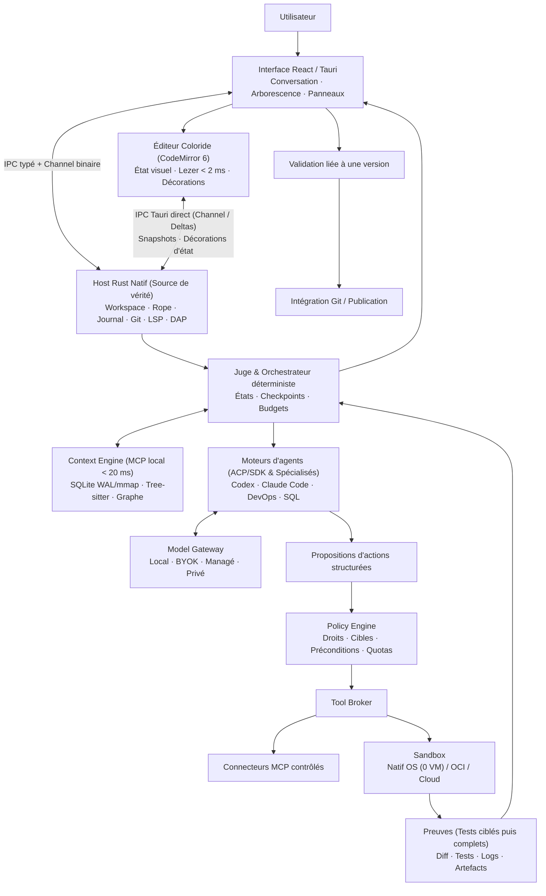
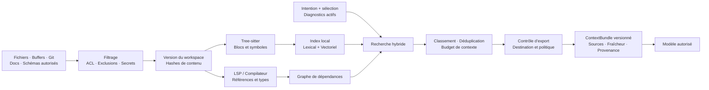

# Coloride — Dossier d’architecture et plan de développement

## 1. Vision produit et adaptation aux cinq personas

### Synthèse et décisions de cadrage

**Coloride sera un environnement de réalisation logicielle où chaque action proposée par une IA reste soumise à un contrôle déterministe, une exécution isolée et des preuves vérifiables.**

Le plan s’appuie sur les douze pages de l’étude stratégique initiale (*Stratégie IDE IA Next-Gen*).

Les choix confirmés sont les suivants :

- **MVP destiné d’abord aux développeurs**, centré sur TypeScript et React.
- **Mode local/BYOK et cloud managé disponibles dès le MVP.**
- **macOS, Windows et Linux disponibles dès le MVP.**
- **Deux fondateurs au départ**, puis recrutements avant la première sortie.
- **Éditeur fondé sur CodeMirror 6 couplé directement au Host Rust, sans Monaco**, intégré dans l’interface React/Tauri ; le chat, l’arborescence et les panneaux restent web.
- Couverture complète des cinq personas en V1.
- Nouveau socle applicatif : le dépôt actuel contient des documents stratégiques, sans implémentation à reprendre.

**Décision actualisée le 8 novembre 2026 :** l’adoption de **CodeMirror 6** comme vue d’édition couplée directement au **Host Rust natif** remplace l’intégration de Monaco. Ce choix garantit une empreinte mémoire réduite, une architecture en deux couches (WebView ↔ Host Rust) avec une seule autorité de persistance, un support mature pour l’IME, l’accessibilité et la virtualisation DOM, et concentre l’effort d’ingénierie sur l’orchestration d’agents, le diff vérifié et les décorations d’état Coloride.

L’étude fournit une direction pertinente : cockpit d’agents, contexte local, isolation et budgets. Quatre propositions doivent être corrigées avant leur traduction technique :

| Proposition de l’étude | Décision d’architecture |
|---|---|
| Rust garantirait un démarrage inférieur à 100 ms et moins de 150 Mo de RAM | Remplacer ces promesses par des objectifs mesurés sur l’application complète, avec périmètre et matériel documentés. |
| MCP assurerait l’isolation et l’abstraction des modèles | Séparer connecteurs MCP, adaptateurs de modèles, autorisations et isolation d’exécution. MCP organise les échanges avec les outils et les ressources. |
| WASM permettrait une compatibilité légère avec les extensions VS Code | Combiner deux niveaux : (1) plugins natifs confinés via Wasmtime/WASI et chargement déclaratif `.vsix` (OpenVSX : thèmes, icônes, snippets, grammaires, LSP/DAP) dans le Host Rust ; (2) un **VS Code Extension Host Shim** isolé dans la Sandbox OS traduisant la surface API `vscode.*` (`commands`, `workspace`, `languages`, `window`) vers le Host Rust (`ropey`) et CodeMirror 6. |
| Local-first et BYOK supprimeraient les risques et les coûts | Mesurer les transferts réels et les coûts d’exploitation ; BYOK transfère le coût d’inférence à l’utilisateur sans supprimer les autres charges. |

Ces distinctions suivent les périmètres documentés de [MCP](https://modelcontextprotocol.io/docs/learn/architecture), de [CodeMirror 6](https://codemirror.net/docs/guide/) et de [Monaco](https://github.com/microsoft/monaco-editor).

### Matrice d’adaptation UX/UI

Un même workspace alimente trois présentations : **Créer**, **Apprendre** et **Développer**. Les espaces **Infrastructure** et **Données** ajoutent des outils spécialisés.

| Persona | Interface et parcours | Adaptation architecturale | Contrôle utilisateur |
|---|---|---|---|
| **Grand public / No-Code** | Conversation, sélection visuelle, aperçu, historique compréhensible, bouton Publier | Templates React et catalogue de composants ; édition visuelle transformée en modifications de code ; exécution et hébergement managés | Valider le résultat visuel, connaître le coût, revenir à une version publiée |
| **Développeur débutant** | Éditeur accompagné d’explications, diagnostics contextualisés, corrections guidées | LSP pour les erreurs ; agent pédagogique recevant diagnostic, code pertinent et résultat des tests | Comprendre une correction avant application ; afficher progressivement diff, terminal et debugger |
| **Développeur senior** | Éditeur Coloride, arborescence complète, navigation, diff multi-fichiers, terminal, debugger, supervision des tâches | Graphe du projet, conventions versionnées, workspaces isolés, agents parallèles à partir de la V1 | Définir périmètre, budget, politique d’autonomie et critères de validation |
| **Ingénieur DevOps** | Plans d’infrastructure, pipelines, inventaire, incidents et journaux corrélés | Connecteurs Terraform, Ansible, GitHub Actions et Kubernetes ; identités temporaires ; exécuteur de déploiement séparé | Examiner la cible et le plan exact avant toute modification de production |
| **DBA** | Schémas, SQL, plans d’exécution, comparaison de performances et migrations | Connecteur PostgreSQL, statistiques, clones assainis et exécuteur de migrations | Accès en lecture par défaut ; contrôle des verrous, sauvegardes et changements destructifs |

**Adaptation progressive :**

- Le profil initial est choisi explicitement et reste modifiable par workspace.
- Des suggestions facultatives proposent davantage de détails selon les fonctions utilisées.
- Aucun panneau ne disparaît automatiquement pendant une tâche.
- L’arborescence reste disponible dans tous les modes ; elle est affichée par défaut dans le mode Développer et accessible à la demande dans le parcours grand public.
- Le niveau d’expertise ne modifie jamais les permissions.
- Les composants visuels s’appuient sur des identifiants stables et des transformations AST. Un composant arbitraire non reconnu reste éditable en code et visible dans l’aperçu.

Le code demeure la source de vérité. Le produit ne promet pas une conversion visuelle universelle de tout programme.

### Disposition de l’interface : Le « Cockpit Multi-Chat » en 4 zones

Contrairement aux éditeurs classiques où le chat est relégué dans une colonne étroite, Coloride place le **pilotage multi-agents au centre** tout en conservant les repères ergonomiques de VS Code :

```text
┌────┬──────────────────┬───────────────────────────────────────────────┬────────────────────────────┐
│ACT.│ 1. PANNEAU GAUCHE│ 2. CENTRE : ONGLETS & JUSQU'À 8 CHATS //      │ 3. DROITE : INSPECTEUR     │
│BAR │   (Dynamique)    │ [💬 Chat 1 🟢][💬 Chat 2 🟡][⊞ Grille 1/4/8]  │ [ 👁 Preview | 💻 Code ]   │
├────┼──────────────────┼───────────────────────────────────────────────┼────────────────────────────┤
│ 💬 │ SESSIONS / CHATS │ ┌─────────────────────┬─────────────────────┐ │ src/auth/login.tsx         │
│ 📁 │ ▸ 🟢 #1 Login UI │ │ 🟢 Chat #1 (Codex)  │ 🟡 Chat #2 (Claude) │ │ ────────────────────────── │
│ 🔍 │ ▸ 🟡 #2 Stripe   │ │ "Créer Login UI"    │ "Webhook Stripe"    │ │ 10│🔵 export function...   │
│ 🌿 │ ▸ 🔴 #3 Auth DB  │ │ ✓ 4 tests passés    │ ! Choix EUR / USD ? │ │ 11│🟢 ✓ const ok = auth()  │
│ 🐛 │ ▸ 🟢 #4 Navbar   │ │ [Diff] [✓ Accepter] │ [EUR] [USD] [Diff]  │ │ 12│🟡 ! currency = 'EUR'   │
│ 🔌 │ ───────────────  │ ├─────────────────────┼─────────────────────┤ │   │   [✓ Accepter] [✕ Rej] │
│ ⚙️ │ (Ou Arborescence │ │ 🔴 Chat #3 (Codex)  │ 🟢 Chat #4 (Claude) │ │ (Ou bascule instantanée    │
│ 👤 │  si icône 📁)    │ │ ✕ Échec test #2     │ ✓ Preview 0 erreur  │ │  sur 👁 Preview en direct) │
└────┴──────────────────┴───────────────────────────────────────────────┴────────────────────────────┘
```

1. **Extrême gauche — `Activity Bar` (style VS Code) :** barre d’icônes verticale permettant de basculer le panneau latéral entre **💬 Sessions de Chat** (par défaut), **📁 Explorateur de fichiers**, **🔍 Recherche globale** (SQLite FTS5), **🌿 Git & Checkpoints**, **🐛 Debug & Tests** et **🔌 Connecteurs MCP / Modèles**.
2. **Gauche — Panneau latéral dynamique :** affiche la liste des conversations/agents avec leur pastille d’état (`🟢/🟡/🔴/🟠`) ou l’arborescence des fichiers annotée par état de validation.
3. **Centre — Zone principale à onglets et Grille Multi-Chat (1 à 8 chats simultanés) :** barre d’onglets avec sélecteur de disposition (`1 | 2 | 4 | 8 chats`). Chaque chat actif s’exécute dans son propre `git worktree` isolé et affiche son contour de couleur Coloride en temps réel.
4. **Droite — Inspecteur contextuel (`[ 👁 Preview | 💻 Code & Diff ]`) :** synchronisé en `< 10 ms` avec le chat sélectionné au centre. L’utilisateur bascule en un clic entre l’aperçu web interactif (`Preview Service`) et l’éditeur **CodeMirror 6** (code et diff `@codemirror/merge` colorés).

### Sémantique des couleurs et états de validation Coloride

Pour garantir la lisibilité et l’accessibilité (daltonisme, lecteurs d’écran), chaque état combine une **couleur**, une **icône distincte** et un **libellé explicite** liés au hash exact de la révision du document :

| État Coloride | Icône & Libellé | Condition exacte d’obtention | Action utilisateur / transition |
|---|---|---|---|
| 🟢 **Vert** | `✓ Validé` | Compilation réussie, `vtsls`/Biome sans erreur et 100 % des tests impactés réussis dans la sandbox sur le snapshot courant | Prêt à fusionner ou publier ; passe immédiatement à `⟳ Validation périmée` dès qu’un caractère de la plage est modifié |
| 🟡 **Jaune / Ambre** | `! À examiner` | Patch généré par un agent en attente d’arbitrage humain, décision d’architecture ou avertissement non bloquant | Revue interactive via `@codemirror/merge` (Accepter, Rejeter ou Demander un ajustement) |
| 🔴 **Rouge** | `✕ Échec` | Erreur de compilation, erreur de type (`vtsls`), règle Biome bloquante ou test en échec dans la sandbox | Inspection de la trace d’erreur corrélée ; correction manuelle ou relance ciblée de l’agent (max 2 essais auto) |
| 🟠 **Orange / Gris** | `⟳ Validation périmée` | Plage précédemment `✓ Validé` mais modifiée localement par l’utilisateur après le passage des tests | Re-vérification incrémentale automatique en arrière-plan pour rétablir l’état `✓ Validé` ou `✕ Échec` |
| 🔵 **Bleu** | `• Source inchangée` | Code d’origine ou d’infrastructure non modifié par la tâche courante | Édition normale ; sert de référence stable dans le workspace |

## 2. Architecture globale, Context Engine et exécution

### Organisation du système

Le MVP adopte un **monolithe modulaire Rust côté host**, avec des processus séparés pour les composants coûteux ou exposés : indexation, modèles locaux, serveurs de langage et sandboxes. L’interface reste React/Tauri. La vue d’édition repose sur **CodeMirror 6**, avec un cycle de mise à jour indépendant des panneaux React et une synchronisation directe par deltas avec le **Host Rust natif**.



**Principe central : le modèle propose ; le système autorise et exécute.** Aucun texte généré ne devient directement une commande privilégiée.

### Core Editor Engine

| Composant | Responsabilité et choix |
|---|---|
| Workspace & Document Service (Host Rust) | Autorité unique de persistance : buffers en mémoire (`ropey`), démarrage paresseux (*Lazy Boot* avec restauration instantanée de session), journalisation durable, sauvegarde atomique et récupération après crash |
| Git & Checkpoint Service | **Time-Travel Checkpoints** invisibles (`refs/coloride/checkpoints/<task_id>`) avant chaque action d’agent permettant d’annuler une tâche multi-fichiers en 1 clic sans polluer `git log` ; branches de tâches et diffs conditionnés à la version courante |
| Editor View (CodeMirror 6) | Rendu DOM virtualisé indépendant de React : saisie optimiste immédiate (`EditorState`), coloration locale instantanée (< 2 ms via Lezer) enrichie progressivement par Tree-sitter/LSP, et extensions `StateField` / `Decoration` pour les états Coloride |
| Diff Service / Review View | Éditions agents anclées sur l’AST (`Tree-sitter`) ou blocs `SEARCH/REPLACE` vérifiés ; calcul du diff exact dans le Host Rust sur snapshots immuables et présentation via `@codemirror/merge` |
| Language & Quality Service | `vtsls` (et adaptateur prêt pour `tsgo` / TypeScript 7 natif) + **Biome** (Rust) pour le linting et le formatage en quelques millisecondes ; démarrés en arrière-plan et projetés dans CodeMirror 6 |
| Debug Service | DAP avec adaptateur JavaScript ; lancement, évaluation et terminal soumis aux permissions |
| Terminal Service | `xterm.js` et PTY supervisé via flux binaires Tauri `Channel` ; commandes des agents exécutées dans la sandbox |
| Preview Service (Browser Loop) | Origine distincte sans pont IPC Tauri ; capture automatique des erreurs runtime (`console.error`, exceptions non gérées, échecs réseau) et de l’arbre DOM/accessibilité pour alimenter les preuves `Evidence` avant d’accorder l’état `🟢 ✓ Validé` |
| Migration, Onboarding & VS Code Extension Emulator | Import en 1 clic au premier lancement (VS Code / Cursor / Claude Desktop : raccourcis clavier, thèmes, MCP, `.cursorrules` / `CLAUDE.md`) + support des paquets `.vsix` **OpenVSX** (actifs déclaratifs dès le MVP et **VS Code Extension Host Shim** isolé traduisant l’API `vscode.*` vers le Host Rust et CodeMirror 6) |

Tree-sitter produit une structure syntaxique incrémentale directement dans le Host Rust ; les informations sémantiques viennent du LSP et des compilateurs. Un lien de dépendance déduit heuristiquement porte un niveau de confiance. [Documentation Tree-sitter](https://tree-sitter.github.io/tree-sitter/).

Les dépôts non approuvés ne peuvent pas déclencher librement hooks Git, scripts de démarrage, extensions ou processus de langage sur l’hôte.

### Architecture d’édition à deux couches : CodeMirror 6 + Host Rust

**Périmètre confirmé :** Coloride utilise **CodeMirror 6** pour la couche d’interaction et d’affichage dans la WebView, couplé directement au **Host Rust natif** via IPC Tauri. React gère le chat, les onglets, l’arborescence et les panneaux.

**Fonctionnement interne et avantages de la séparation en deux couches :**

- **Latence de frappe minimale (UI optimiste) :** CodeMirror 6 maintient son `EditorState` immuable (structure en arbre de texte) pour le rendu immédiat de la frappe, la composition IME native du navigateur, le multicurseur et l’accessibilité (lecteurs d’écran), sans bloquer sur un aller-retour IPC.
- **Autorité unique dans le Host Rust :** chaque transaction locale validée dans CodeMirror 6 émet un delta compact et versionné vers le Host Rust via IPC. Le Host Rust applique ce delta à sa structure de texte native (`ropey`), écrit le journal de récupération et alimente directement en mémoire — sans repasser par la WebView — Tree-sitter, le serveur LSP, le `Context Engine` et les snapshots des agents.
- **Économie mémoire et suppression du Split-Brain :** le document actif n’est maintenu que dans la vue active CodeMirror 6 et dans le Host Rust. Les conversions d’offsets (octets UTF-8 pour Rust/Tree-sitter, UTF-16 pour LSP et positions CodeMirror) sont centralisées dans le pont Host Rust ↔ CodeMirror.
- **Décorations d’état Coloride natives :** les états d’exécution et de validation (🟢 Validé, 🟡 En révision, 🔴 Échec, 🔵 Infrastructure, validation périmée) sont injectés sous forme de `StateEffect` et `Decoration` CodeMirror 6 liés au hash exact de la révision testée. Dès qu’une plage couverte est modifiée par l’utilisateur, CodeMirror invalide localement le badge vert en attendant le nouveau cycle du Host Rust.
- **Coédition V1 prête à l’emploi :** en V1, l’intégration collaborative s’appuie sur `y-codemirror.next` (Yjs) avec `UndoManager` isolé par origine (séparant l’historique d’annulation de l’utilisateur des actions d’agents ou de collaborateurs distants), synchronisé avec le Host Rust.

**Révisions et récupération :** chaque document porte un identifiant et une génération de session. On distingue la révision interactive affichée dans CodeMirror 6, la révision durablement journalisée par le Host Rust et celle sauvegardée sur disque. Le statut « sauvegardé » exige une écriture disque réussie de la révision correspondante ; une édition survenue entre-temps laisse le document modifié.

Avant une sauvegarde, un contexte agent ou un snapshot de test, le Host Rust synchronise le dernier delta acquitté de CodeMirror 6 (en attendant la fin d’une éventuelle composition IME en cours) et fige une révision précise. Le contexte peut inclure des changements non enregistrés, sans imposer leur sauvegarde sur disque. Tous les patchs d’agents passent par le Host Rust qui vérifie la révision de base, puis pousse une transaction versionnée vers CodeMirror 6. Après un crash de la WebView ou de l’application, le Host Rust restaure le dernier journal confirmé.

| Jalon | Fonctions de l’éditeur (CodeMirror 6 + Host Rust) |
|---|---|
| **MVP** | CodeMirror 6 intégré hors du cycle de re-rendu React ; synchronisation de deltas avec le Host Rust (`ropey` + journal) ; coloration, diagnostics/navigation/complétion LSP ; diff unifié et côte-à-côte (`@codemirror/merge`) ; décorations d’état Coloride liées aux snapshots ; gestion des conflits disque |
| **Bêta** | Multicurseur complet, snippets, pliage de code, retour visuel à la ligne, recherche/remplacement avancés, optimisation de l’ouverture des très grands fichiers (mode dégradé au-delà d’un seuil de taille) |
| **V1** | Coédition temps réel via `y-codemirror.next` (Yjs), undo/redo isolé par origine (humain vs agent vs pair), widgets de revue inline enrichis et éditeurs spécialisés pour les espaces DevOps (HCL/YAML) et SQL |

### Context Engine : contexte précis, actualisé et traçable



Décisions d’implémentation :

1. **Stockage local chaud (0 Mo requis au premier lancement) :** SQLite en mode `WAL` (`synchronous = NORMAL`, `mmap_size` actif pour lectures en mémoire mappée) pour les métadonnées et le graphe, **FTS5 (BM25) + graphe de symboles Tree-sitter/LSP** actifs immédiatement sans téléchargement de modèle, et `sqlite-vec` avec modèle d’embedding compact (< 150 Mo) téléchargé à la demande. Index reconstruisibles à partir des sources.
2. **Indexation incrémentale avec *debounce* :** mise à jour des fichiers modifiés uniquement après une pause de frappe (*debounce*) ou lors des jalons de tâche afin de ne jamais concurrencer les threads d’édition ; invalidation lors des changements de branche, suppressions et changements du modèle d’embedding.
3. **Recherche hybride et analyse d’impact :** fusion des résultats lexicaux et vectoriels, puis enrichissement par les imports, références, tests voisins et diagnostics. Le graphe de dépendances identifie également les tests directement impactés par une modification (*Test Impact Analysis*).
4. **Buffers prioritaires :** les modifications non enregistrées font partie du snapshot de tâche. Une réponse ne doit pas s’appuyer silencieusement sur une ancienne version disque.
5. **Fenêtre maîtrisée :** budget initial de 16 000 tokens de contexte récupéré, réduit selon les limites du modèle et la réserve de sortie. Les tâches importantes récupèrent le contexte par étapes.
6. **Dégradation explicite :** si l’index vectoriel est indisponible, recherche lexicale et symbolique ; si le code est incomplet, extraction textuelle avec indication de confiance.
7. **Mémoire d’équipe :** conventions et décisions proposées à validation, versionnées et révocables. Une réponse de modèle ne devient pas automatiquement une règle.

Les ACL s’appliquent avant la récupération et avant l’envoi. Code, commentaires et résultats MCP restent des données non fiables : leur contenu ne peut pas modifier la politique d’exécution.

### Orchestration hybride : Moteurs d’agents (ACP / SDK) + Juge déterministe Coloride

Plutôt que de réinventer de zéro un agent généraliste de génération de code, Coloride sépare **l’intelligence de génération** (moteurs d’agents connectables ou natifs) et **le Juge déterministe en Rust** (la valeur propre de Coloride) :

- **Moteurs d’agents connectables (Chat / Codeur) :** via le protocole **ACP (Agent Client Protocol)**, SDK ou CLI supervisé, l’utilisateur peut piloter **Claude Code**, **OpenAI Codex**, **GitHub Copilot SDK**, **OpenCode** ou l’agent managé Coloride directement dans l’interface. Coloride expose son `Context Engine` (SQLite FTS5 + graphe Tree-sitter/LSP) comme serveur MCP local ultra-rapide (< 20 ms) pour ces agents.
- **Le Juge / Arbitre Coloride (100 % Rust déterministe) :** aucune action d’un agent externe ou interne ne s’applique directement sans contrôle. Le Host Rust crée un **Checkpoint Time-Travel** (`refs/coloride/checkpoints/<task_id>`), intercepte les modifications, exécute `vtsls` + `Biome` + les tests impactés dans la sandbox + la vérification de rendu du `Preview Service`, et attribue l’état **🟢 Vert**, **🟡 Jaune** ou **🔴 Rouge**. En cas de **🔴 Rouge**, le Juge renvoie automatiquement le diagnostic structuré à l’agent pour correction (jusqu’à 2 cycles).
- **Micro-agents spécialisés Coloride :** flux légers dédiés à la traduction pédagogique (modes *Grand public / Débutant*), à l’autocomplétion locale rapide (< 700 ms) et, en V1, aux spécialistes **DevOps** et **DBA/SQL** couplés à leurs exécuteurs sécurisés.

| Rôle / Composant | Origine & Exécution | Responsabilités et limites |
|---|---|---|
| **Moteur Codeur (Externe ACP/SDK ou Managé)** | Codex, Claude Code, Copilot SDK ou modèle managé/local | Produit le plan et les `ChangeSet` dans un worktree isolé ; ne délivre aucune autorisation |
| **Juge / Reviewer Déterministe Coloride** | **Host Rust natif** + Sandbox + `Preview Service` | Crée le checkpoint, exécute `vtsls`/Biome/tests/preview, produit `Evidence` et fixe la couleur (`🟢`/`🟡`/`🔴`) |
| **Micro-Agent Pédagogique & UX** | Prompt léger géré par Coloride | Traduit les diffs, erreurs et coûts en langage clair pour les modes *Créer* et *Apprendre* |
| **Spécialiste DevOps (V1)** | Agent + connecteurs Terraform/Ansible/CI/K8s | Analyse en lecture ; mutations uniquement via exécuteur dédié après approbation du plan |
| **Spécialiste SQL / DBA (V1)** | Agent + connecteur PostgreSQL & clones assainis | Introspection et `EXPLAIN` ; aucun privilège administrateur implicite |

Le MVP utilise un Codeur et un Reviewer **séquentiels**. La V1 autorise des tâches parallèles sur des workspaces distincts et un graphe de dépendances explicite.

Cycle d’une tâche :

`Created → ContextReady → Planned → Running → Verifying → AwaitingReview → Applied`

États supplémentaires : `Paused`, `Failed`, `Cancelled`, `NeedsReconciliation`.

- Journal durable avant et après les actions.
- Transitions communes dans une bibliothèque Rust ; stockage SQLite local et PostgreSQL cloud.
- Transactions, outbox, leases et jetons de génération pour empêcher un worker expiré de publier.
- Clés d’idempotence et rapprochement avec l’état externe après interruption.
- Aucun retry aveugle d’un déploiement ou d’une migration dont le résultat est inconnu.
- Deux cycles de correction automatiques maximum par défaut ; arrêt si le même échec se répète.

Les traces partagées contiennent plans, décisions résumées, appels d’outils et preuves d’exécution.

### Contrats techniques à stabiliser dès le socle

| Interface/type | Contrat minimal |
|---|---|
| `EditorTransaction` | Document, génération de session, révision de base, identifiant d’opération, changements de texte, sélection et origine ; unités de position explicites |
| `EditorSnapshot` | Document, génération, révision et hash du contenu ; état de journalisation et de sauvegarde distingués ; support des buffers non enregistrés |
| `TaskSpec` | Objectif, workspace, snapshot de base, cible, politique, budget, critères d’acceptation |
| `ContextBundle` | Extraits sourcés, versions, fraîcheur, classification et destination autorisée |
| `ModelProvider` | Capacités déclarées, génération en streaming, appels d’outils structurés, annulation et usage |
| `ToolCall` | Outil, arguments validés, capacités requises, préconditions et clé d’idempotence |
| `ChangeSet` | Opérations sémantiques AST (`Tree-sitter`) ou blocs `SEARCH/REPLACE` ancrés sur les symboles, compilés par le Host Rust en patch exact ; version de base, fichiers affectés et digest du résultat |
| `Evidence` | Snapshot testé, checkpoint Git associé, commandes, codes de sortie, diagnostics `vtsls`/Biome, rapport runtime du `Preview Service` (0 `console.error`/crash) et artefacts |
| `Approval` | Identité, cible, action, digest approuvé et expiration |

Les schémas sont versionnés, validés côté Rust et projetés en types TypeScript. Un changement du patch, de la cible ou du plan invalide l’approbation correspondante.

### Isolation et sécurité d’exécution (Sans Docker obligatoire)

Pour garantir un onboarding en un clic sans imposer l’installation de Docker ou d’une machine virtuelle lourde, l’isolation locale repose sur **trois niveaux progressifs** :

| Environnement | Choix retenu | Restrictions et optimisations de vitesse |
|---|---|---|
| **1. Local par défaut (Sans Docker / 0 VM)** | **Sandbox native du système d’exploitation** (`sandbox-exec`/Seatbelt sur macOS, `Landlock` + `bubblewrap`/namespaces sur Linux, `AppContainer` + `Job Objects` sur Windows) combinée à un `git worktree` ou clone *Copy-on-Write* (APFS/reflinks) | Démarrage en **< 5 ms**, 0 Mo de RAM de VM ; écriture restreinte au worktree temporaire, blocage de `~/.ssh`, `~/.aws` et du réseau sortant par défaut ; exécution prioritaire des tests impactés + Biome |
| **2. Local conteneurisé (Optionnel / Multi-services)** | Abstraction OCI automatique compatible avec **OrbStack, Docker Desktop ou Podman** (utilisée uniquement si présente et requise par la tâche) | Pool de conteneurs pré-chauffés (*Warm Sandbox Pool*) avec cache paquets en lecture seule (`pnpm`/`bun`) ; pas de montage du dossier personnel ni de socket de conteneur |
| **3. Cloud MVP** | Une tâche ECS Fargate par exécution, sans partage entre tenants | Aucun mode privilégié, aucun Docker-in-Docker ; stack TypeScript prédéfinie avec cache d’images et de dépendances pré-positionné |
| **4. V1/Enterprise** | Backend Firecracker pour les jobs nécessitant davantage de contrôle et les environnements privés compatibles | Workers Linux/KVM durcis avec restauration rapide de snapshots microVM ; jamais présenté comme runtime natif macOS/Windows |
| **Extensions & Émulateur VS Code** | Wasmtime/WASI + **VS Code Extension Host Shim** (isolé en Sandbox OS) | Plugins natifs WASI à capacités explicites ; émulateur d’API `vscode.*` (`commands`, `workspace`, `languages`, `window`) pour exécuter les extensions `.vsix` d’OpenVSX dans un processus confiné sans accès direct au système hôte |

L’utilisateur peut ainsi utiliser Coloride dès l’installation sans Docker ni Podman grâce à la sandbox native de l’OS. Lorsque des conteneurs sont nécessaires (bases de données de test, environnements multi-services), le Host Rust détecte un runtime OCI existant (OrbStack, Docker, Podman) ou bascule sur le runner cloud autorisé. [Fargate](https://docs.aws.amazon.com/AmazonECS/latest/developerguide/fargate-security-considerations.html), [Firecracker](https://github.com/firecracker-microvm/firecracker/blob/main/docs/prod-host-setup.md).

Garde-fous communs :

- Quotas CPU, mémoire, disque, processus, durée et volume de logs.
- Réseau sortant refusé par défaut ; dépendances téléchargées via un proxy contrôlé.
- Secrets LLM conservés dans le broker, hors des environnements de build.
- Aucun rôle cloud de déploiement accessible au code généré.
- Chemins canoniques, contrôles des liens symboliques et protections contre les traversées de répertoires.
- Aucun repli silencieux vers le shell hôte si la sandbox est indisponible.
- Aperçus et applications publiées isolés des origines de contrôle.

## 3. Stack retenue et ADR simplifiés

### Comparatif du runtime client

| Option | Avantages | Coûts et contraintes | Décision |
|---|---|---|---|
| **Tauri 2 + Rust** | Noyau système typé, capacités IPC, utilisation de la WebView du système | Variations WebKit/WebView2 ; validation indispensable sur chaque OS | **Retenu** |
| **Electron** | Chromium homogène, outillage mature et intégration Node simple | Runtime embarqué supplémentaire ; surface Node à contrôler | Non retenu pour ce nouveau socle |
| **Web-first** | Distribution immédiate et onboarding simple | Accès local et fonctionnement autonome plus contraints | Portail cloud ; pas le client principal |

Tauri utilise des moteurs différents selon les plateformes ; son choix ne dispense donc pas d’une matrice de tests native. [Modèle de processus Tauri](https://v2.tauri.app/concept/process-model/).

### Décisions par sous-système

| ADR | Choix | Justification et compromis |
|---|---|---|
| UI | React, TypeScript, Vite, store atomique (Zustand/Jotai), CodeMirror 6 et xterm.js | Isolation stricte des re-rendus : le streaming IA et les logs sont cadencés à 16 ms (`requestAnimationFrame`) sur des listes virtualisées sans impacter l’éditeur |
| Édition | CodeMirror 6 (Lezer < 2 ms) côté WebView + `ropey` et journal dans le Host Rust via `tauri::ipc::Channel` | Saisie optimiste immédiate, coloration à deux vitesses (Lezer local puis Tree-sitter/LSP), flux IPC binaires sans surcoût de sérialisation JSON |
| Noyau | Rust, Tokio, *Lazy Boot* et interfaces de stockage/exécution | Restauration instantanée de la fenêtre et du fichier actif au démarrage ; lancement différé de `vtsls`/Biome, SQLite et sandboxes sur des threads de basse priorité |
| Orchestration | Machine à états persistante, sans framework d’essaim autonome | Contrôle des transitions, des reprises et du coût ; pas de dépendance cloud pour le mode local |
| API cloud | Rust/Axum, REST/OpenAPI, SSE pour les événements, WebSocket pour les terminaux | Contrats typés, reconnexion par curseur et séparation des flux |
| Stockage cloud | PostgreSQL, stockage objet compatible S3 / Cloudflare R2, KMS | Métadonnées transactionnelles ; artefacts identifiés par digest et isolés par tenant sans frais de bande passante sortante (*zero egress*) |
| Hébergement MVP | AWS (région UE : ECS Fargate, RDS PostgreSQL) + Cloudflare R2/Pages pour la publication statique | Réduction de l’exploitation initiale, propagation instantanée (< 50 ms) et maîtrise des coûts de trafic ; dépendance fournisseur contenue dans les adaptateurs |
| Identité | OIDC Authorization Code + PKCE ; fédération SAML/SCIM en Enterprise | Aucun compte requis pour le local ; identité requise pour les services managés |
| Connecteurs & Agents | MCP (stdio/HTTP) pour les outils ; **ACP (Agent Client Protocol) / SDK** pour intégrer Claude Code, Codex ou agents externes | Catalogue autorisé, scopes et interception systématique des actions par le Juge Rust |
| Collaboration | Événements synchronisés dès la bêta ; Yjs pour la coédition en V1 | Synchronisation activée par workspace ; Git reste responsable des versions publiées |
| Onboarding & Extensions VS Code | Import 1-clic (VS Code / Cursor / Claude Desktop : keymaps, thèmes, MCP, `.cursorrules` / `CLAUDE.md`), client **OpenVSX (`.vsix`)**, plugins WASI et **VS Code Extension Host Shim** isolé | Adoption immédiate sans friction : chargement natif Rust des thèmes/grammaires/snippets `.vsix` dès le MVP, et émulation de la surface API `vscode.*` dans un Extension Host sandboxé relié à `ropey` et CodeMirror 6 |

Les instantanés cloud sont envoyés uniquement pour les tâches explicitement hébergées. L’activation du cloud ne synchronise pas automatiquement tous les dépôts.

### Modèles et routage

Le registre de modèles doit enregistrer fournisseur, identifiant, capacités, limites, prix, politique de données et version de configuration. Pour éviter de multiplier les moteurs d’inférence en mémoire, l’exécution locale est **unifiée sur un seul runtime** (`llama.cpp` embarqué par le Host Rust ou connexion à une instance Ollama existante), et la recherche de contexte fonctionne immédiatement sans téléchargement obligatoire.

| Usage | Choix initial | Règle de routage |
|---|---|---|
| Complétion courte | Qwen2.5-Coder 1.5B quantifié (runtime local unifié `llama.cpp` / Ollama) | Local, contexte proche du curseur ; annulation immédiate après nouvelle frappe |
| Explication et petites transformations | Qwen2.5-Coder 7B Instruct (même runtime local unifié) | Option locale selon la RAM/VRAM disponible ; pas de garantie de parité avec les modèles distants |
| Recherche de contexte et sémantique | **SQLite FTS5 (BM25) + Graphe Tree-sitter/LSP** par défaut (0 Mo) ; modèle d’embedding compact (`nomic-embed-code` / `bge-small` < 150 Mo) en option | Recherche lexicale et structurelle instantanée dès l’ouverture ; indexation vectorielle optionnelle en arrière-plan |
| Code et revue managés | `claude-sonnet-5-5` | Configuration initiale du service, soumise aux évaluations du produit |
| Raisonnement complexe | `gpt-6-astra` | Escalade permise par la politique et le budget ; jamais automatique vers une destination interdite |
| Entreprise privée | Endpoint vLLM homologué | Modèle choisi dans le catalogue de l’organisation ; tests de compatibilité des capacités |

Ces modèles constituent une **configuration initiale à évaluer**, pas un classement universel. Les références consultées documentent [Qwen2.5-Coder](https://arxiv.org/abs/2409.12186), [Sonnet 5.5](https://platform.claude.com/docs/en/models/sonnet-5-5/overview) et les [modèles OpenAI pour le code](https://developers.openai.com/api/docs/guides/code-generation).

Les clés BYOK restent dans le coffre du système et les appels partent directement du host. Le service managé utilise ses propres credentials côté serveur. Le `Model Gateway` structure systématiquement les requêtes (instructions système, graphe du dépôt et fichiers stables en préfixe avec marqueurs `cache_control`) pour exploiter le **Prompt Caching** natif des fournisseurs, réduisant de 75 à 90 % le coût des boucles Codeur/Reviewer et la latence du premier token (TTFT). Une panne fournisseur suspend la tâche ou utilise un fournisseur de secours déjà autorisé.

### Publication et opérations spécialisées

**MVP :** publication React/Vite statique sur **Cloudflare R2 + Cloudflare Pages/Workers** (0 $ de frais d’*egress* et invalidation globale en < 50 ms) ou via connecteur externe au choix de l’utilisateur (Vercel, GitHub Pages). Le bouton Publier promeut l’artefact testé, identifié par digest. Les anciennes versions restent disponibles pour restauration en un clic. SSR, API serveur et secrets dans le bundle sont exclus de ce premier parcours.

**V1 DevOps :** génération Terraform/Ansible et GitHub Actions ; diagnostic Kubernetes en lecture ; application d’un plan approuvé par un exécuteur séparé. Les plans Terraform sont traités comme des artefacts sensibles, car ils peuvent contenir des secrets. [Documentation Terraform](https://developer.hashicorp.com/terraform/cli/commands/plan).

**V1 DBA :** PostgreSQL en premier, introspection et `EXPLAIN (FORMAT JSON)` en lecture. `EXPLAIN ANALYZE` s’exécute sur un clone assaini, car il exécute effectivement la requête. Migrations selon une stratégie expand/contract, avec limites de verrous et restauration répétée. Aucun rollback universel n’est promis. [Documentation PostgreSQL](https://www.postgresql.org/docs/18/sql-explain.html).

## 4. Roadmap en quatre phases

**L’adoption de CodeMirror 6 couplé directement au Host Rust offre une base d’édition légère et immédiatement exploitable.** L’équipe peut concentrer le MVP sur la proposition de valeur distinctive de Coloride : la synchronisation déterministe entre l’éditeur et le Host Rust, le Context Engine hybride, l’exécution isolée en sandbox et la validation visuelle par états de couleur.

| Phase | Objectifs et livrables | Équipe et compétences | Risques majeurs et atténuation | Critères de sortie |
|---|---|---|---|---|
| **1. MVP** | Éditeur CodeMirror 6 + Host Rust (`ropey`/journal) et diff (`@codemirror/merge`) ; décorations d’état Coloride ; Tauri sur trois OS ; TypeScript/React ; local/BYOK et cloud ; contexte hybride ; Codeur/Reviewer ; tests, preview et publication statique | **2 → 4 personnes** : fondateurs produit/frontend et Rust/IA ; ingénieur plateforme/sandbox et QA avant la sortie. Expertise sécurité ponctuelle | Synchronisation IPC des deltas : tests de propriétés sur les révisions. Dispersion : stack métier unique. WebView : essais sur les trois OS. Pertes de fichiers : versions et journal. Coûts : quotas | Saisie fluide, sauvegarde et reprise après crash validées ; parcours agent complet sur les trois OS ; aucun écrasement utilisateur ; budget appliqué ; revue de sécurité |
| **2. Bêta fermée — après stabilisation du MVP** | 20–50 utilisateurs ; extensions CodeMirror avancées (snippets, pliage, grands fichiers) ; ergonomie débutant ; édition visuelle du catalogue ; mémoire de projet ; synchronisation des tâches ; MCP sélectionné | **6 personnes** : ajout ingénieur IA/contexte et designer produit ; maintien plateforme et QA | Désynchronisation d’états de couleur : tests de mutation de révision. Contexte incorrect : corpus de retrieval. Permissions confuses : tests utilisateurs. Providers : contrats et circuit breakers | Mesures qualité/coût/latence ; onboarding autonome ; fonctions avancées de l’éditeur validées ; restauration et déconnexion réseau |
| **3. V1 multi-rôles — après validation des usages bêta** | Cinq personas ; agents parallèles ; backend Node managé ; PostgreSQL ; Terraform/Ansible/CI ; coédition via `y-codemirror.next` et undo par origine ; backend Firecracker | **8–10 personnes** : ajout expertise DevOps/SRE, données/PostgreSQL et sécurité | Conflits agents/coédition : transactions et workspaces séparés. Infrastructure/migrations : plans approuvés et rapprochement d’état. Visuel/code : transformations testées | Scénarios pour chaque persona ; convergence et undo de coédition ; tests de charge ; audit des autorisations ; restauration des applications et bases |
| **4. Scale / Enterprise — après qualification de la V1** | VPC/on-premise ; SSO/SAML/SCIM ; RBAC/ABAC ; politiques centrales ; audit ; haute disponibilité ; modèles privés | **12–15 personnes** : SRE, sécurité, identité, administration plateforme et support entreprise ; accompagnement DPO/juridique | Isolation multi-tenant, mises à jour privées, disponibilité et conformité : tests d’intrusion, déploiements progressifs et exercices de reprise | RPO/RTO vérifiés ; identité ; suppression des données testée ; pilote entreprise accepté ; procédures d’incident opérationnelles |

**Ordre de construction du MVP :**

1. **Socle d’édition et Host Rust :** intégrer CodeMirror 6 hors du cycle de rendu React ; implémenter le pont IPC de deltas versionnés vers le Host Rust (`ropey`, journalisation sur disque, récupération après crash, gestion des conflits disque) et connecter Git, Tree-sitter, `vtsls`/Biome et DAP.
2. **Contexte et sandboxes sans friction :** assembler le Context Engine (SQLite WAL, FTS5 + graphe de symboles, `sqlite-vec` optionnel), la passerelle de modèles et l’isolation à trois niveaux (Sandbox native de l’OS par défaut sans Docker, détection OCI optionnelle et runner Fargate).
3. **Boucle agent AST et états Coloride :** développer l’application de `ChangeSet` ancrés sur l’AST (`Tree-sitter`), les décorations d’état Coloride (vert/jaune/rouge/bleu/périmé) et la vue de diff/revue, puis la boucle patch → tests ciblés → revue → intégration, les budgets et la preview isolée.
4. **Livraison :** terminer les parcours local et cloud, la publication statique, le packaging signé et l’acceptation native sur les trois OS.

Hypothèse de support initial : macOS Apple Silicon, Windows 11 x64 et Ubuntu 24.04 x64. Les autres architectures matérielles seront ajoutées après validation de cette matrice.

### Diagramme de Gantt prévisionnel (MVP → Enterprise)

```mermaid
gantt
    title Roadmap de Développement Coloride (MVP → Enterprise)
    dateFormat  YYYY-MM-DD
    axisFormat  %b %Y

    section Phase 1 : MVP (S1-S8)
    S1-S2 Socle Rust (ropey) + UI Cockpit 4 zones & CodeMirror 6 :a1, 2026-11-09, 28d
    S3-S4 Context Engine (SQLite FTS5/Tree-sitter) + vtsls/Biome :a2, after a1, 28d
    S5-S6 Juge Rust + Sandbox OS Native + Pont ACP (Codex/Claude) :a3, after a2, 28d
    S7-S8 Preview Browser Loop + Cloudflare Pages + Packaging 3 OS :a4, after a3, 28d
    Jalon M1 : Release MVP Alpha :milestone, m1, after a4, 0d

    section Phase 2 : Bêta Fermée (S9-S12)
    S9-S10 Grille Multi-Chat (8 agents //) + Détection conflits AST :b1, after a4, 28d
    S11-S12 Modes Créer/Apprendre + Prompt Caching + Onboarding 50 users :b2, after b1, 28d
    Jalon M2 : Ouverture Bêta Fermée :milestone, m2, after b2, 0d

    section Phase 3 : V1 Multi-Personas (S13-S18)
    S13-S14 Coédition Yjs (y-codemirror.next) + Undo par origine :c1, after b2, 28d
    S15-S16 Espace DBA (PostgreSQL + Clones) & DevOps (Terraform/K8s) :c2, after c1, 28d
    S17-S18 Runners Firecracker + Durcissement Sécurité & Charge :c3, after c2, 28d
    Jalon M3 : Lancement V1 Publique :milestone, m3, after c3, 0d

    section Phase 4 : Enterprise (S19-S24)
    S19-S21 SSO SAML/SCIM + RBAC/ABAC + Endpoints privés vLLM :d1, after c3, 42d
    S22-S24 Déploiement VPC/On-Prem + Audit RGPD & RPO/RTO :d2, after d1, 42d
    Jalon M4 : Qualification Enterprise :milestone, m4, after d2, 0d
```

### Découpage opérationnel par Sprints (Cycles de 2 semaines) et Milestones GitHub

| Milestone GitHub | Sprints | Objectifs majeurs | Livrables clés (Definition of Done) |
|---|---|---|---|
| **`M1.1 - Core & Cockpit Shell`**<br>*(Semaines 1–4)* | **S1 – S2** | Monorepo Cargo/pnpm, Host Rust (`ropey`, journal, crash recovery) et interface **Cockpit 4 zones** (Activity Bar, Panneau latéral, Centre Multi-Chat à onglets, Inspecteur CodeMirror 6 / Preview). | Application Tauri v2 compilant sur macOS/Win/Linux ; synchronisation de deltas CodeMirror 6 ↔ Host Rust via `tauri::ipc::Channel` (< 16 ms) ; import 1-clic depuis VS Code/Cursor. |
| **`M1.2 - Context & Fast Quality`**<br>*(Semaines 5–8)* | **S3 – S4** | Moteur de contexte instantané (0 Mo requis au lancement), analyse AST incrémentale et intégration qualité ultra-rapide. | SQLite `WAL`/`mmap` + FTS5 (BM25) + graphe `Tree-sitter` ; `vtsls` + **Biome** connectés à CodeMirror 6 ; exposition du `Context Engine` en serveur MCP local (< 20 ms). |
| **`M1.3 - The Judge & OS Sandbox`**<br>*(Semaines 9–12)* | **S5 – S6** | Isolation sans Docker obligatoire, checkpoints Git invisibles et boucle de validation d’agents (ACP/SDK : Claude Code, Codex). | Sandbox OS native (`Seatbelt`/`Landlock`/`AppContainer` < 5 ms) sur `git worktree` CoW ; *Time-Travel Checkpoints* (`refs/coloride/checkpoints/*`) ; `ChangeSet` AST et décorations `🟢/🟡/🔴/🟠/🔵`. |
| **`M1.4 - MVP Launch Ready`**<br>*(Semaines 13–16)* | **S7 – S8** | Validation visuelle du frontend, publication 1-clic et packaging signé multi-OS. | `Preview Service` capturant `console.error`/DOM dans `Evidence` ; runner cloud Fargate ; publication statique **Cloudflare R2/Pages** ; binaires signés macOS, Windows et Ubuntu. |
| **`M2.0 - Closed Beta (8-Chat Grid)`**<br>*(Semaines 17–24)* | **S9 – S12** | Ouverture à 20–50 développeurs externes, multi-chats parallèles jusqu’à 8 agents, ergonomie Débutant/No-Code et Prompt Caching. | Grille centrale jusqu’à **8 chats simultanés** sur worktrees isolés avec détection de conflits AST ; `Prompt Caching` (-75 % coûts) ; catalogue de composants visuels et télémétrie OpenTelemetry. |
| **`M3.0 - V1 Multi-Personas`**<br>*(Semaines 25–36)* | **S13 – S18** | Couverture complète des **5 personas** (No-Code, Junior, Senior, DevOps, DBA), coédition temps réel et exécution microVM. | Coédition `y-codemirror.next` (Yjs) avec undo par origine ; connecteur **PostgreSQL** (`EXPLAIN` sur clone assaini) ; plans **Terraform/Ansible/K8s** approuvés ; backend **Firecracker**. |
| **`M4.0 - Scale & Enterprise`**<br>*(Semaines 37–48)* | **S19 – S24** | Gouvernance grands comptes, déploiement privé VPC/on-premise, identité fédérée et haute disponibilité. | SSO **OIDC / SAML / SCIM**, RBAC/ABAC, endpoints privés **vLLM**, audit de conformité RGPD/CNIL, exercices RPO ≤ 15 min / RTO ≤ 4 h validés. |

### Gouvernance GitHub Projects, Labels et Workflow Git (CI/CD)

1. **GitHub Projects V2 (`Coloride — Product & Engineering Roadmap`) :**
   - **Champs personnalisés :** `Status` (`Inbox`, `Ready`, `In Progress`, `In Review`, `🟢 Validated`, `Blocked`), `Sprint` (itérations de 2 semaines), `Priority` (`P0` à `P3`), `Points` (Fibonacci `1–8`), `Crate / Package` (`host-core`, `context-engine`, `judge-orchestrator`, `sandbox-runner`, `editor-cm6`, `web-ui`, `desktop-tauri`), `OS Target` (`macOS`, `Windows`, `Linux`) et `Persona`.
   - **Vues :** `🏃 Sprint Actif (Board)`, `🗺️ Roadmap Exécutive (Roadmap)`, `🧱 Matrice par Crate (Table)` et `🍎🪟🐧 Parité OS (Table)`.
2. **Taxonomie des Labels :**
   - **Types :** `type: feat`, `type: fix`, `type: perf`, `type: sec`, `type: arch`, `type: chore`.
   - **Priorités :** `prio: P0-blocker`, `prio: P1-high`, `prio: P2-medium`, `prio: P3-low`.
   - **Domaines :** `area: host-core`, `area: context-mcp`, `area: judge-acp`, `area: sandbox`, `area: editor-cm6`, `area: cockpit-ui`.
3. **Stratégie de branches (GitHub Flow strict) & Automatisation :**
   - Branche `main` protégée et toujours verte (`🟢`) ; branches courtes (`feat/<issue>-slug`, `fix/<issue>-slug`, `perf/<issue>-slug`, `sec/<issue>-slug`) fusionnées en *Squash & Merge* avec *Conventional Commits*.
   - Templates d’Issues/PR et pipelines GitHub Actions versionnés dans [`.github/`](/Users/ilyesameraoui/Desktop/Coloride/.github) : [ci.yml](/Users/ilyesameraoui/Desktop/Coloride/.github/workflows/ci.yml) (Biome + Typecheck + Matrice Rust sur macOS, Ubuntu 24.04 et Windows) et [project-sync.yml](/Users/ilyesameraoui/Desktop/Coloride/.github/workflows/project-sync.yml).

### Structure cible du Monorepo (Cargo Workspace + pnpm)

Pour démarrer l’implémentation immédiatement avec une séparation nette des responsabilités entre les deux fondateurs :

```text
coloride/
├── apps/
│   ├── desktop-tauri/          # Application Tauri v2 (assemblage fenêtre, menus natifs, updater)
│   └── web-ui/                 # Interface React + Vite + Zustand/Jotai (Chat, Cockpit, Panneaux)
├── packages/
│   ├── editor-cm6/             # Vue CodeMirror 6 isolée, décorations d'état Coloride (🟢/🟡/🔴/🟠/🔵), diff merge
│   └── protocol-types/         # Types TypeScript générés automatiquement depuis les contrats Rust (ts-rs / specta)
└── crates/
    ├── host-core/              # Monolithe modulaire Rust : buffers ropey, journal, Git checkpoints, migration 1-clic
    ├── context-engine/         # SQLite WAL/mmap, FTS5, Tree-sitter, graphe d'impact et serveur MCP local
    ├── judge-orchestrator/     # Machine à états, Policy Engine, pont ACP/SDK (Codex/Claude Code) et validation Evidence
    └── sandbox-runner/         # Exécution isolée : Sandbox OS native (Seatbelt/Landlock/AppContainer), OCI et Cloud
```

## 5. Exigences non fonctionnelles et plan de validation

### Coût, confidentialité et gouvernance

| Domaine | Politique retenue |
|---|---|
| **Budgets** | Limites par tâche, utilisateur et organisation ; réservation du coût maximal estimé avant appel ; plafonds de tokens, durée, outils et ressources sandbox |
| **Boucles d’agents** | Deux corrections automatiques par défaut ; arrêt sur répétition sans progrès ; reprise explicite avec nouveau budget |
| **Optimisation** | **Prompt Caching** natif sur les préfixes de `ContextBundle` ; cache par contenu, modèle et politique ; contexte différentiel ; routage local ; aucune réutilisation de cache entre tenants |
| **Confidentialité** | Mode strictement local sans compte ; destination et données envoyées visibles ; aucun basculement distant silencieux |
| **Secrets** | Coffre OS en local, KMS/Secrets Manager côté service ; credentials temporaires ; détection avant indexation, export et journalisation |
| **Propriété intellectuelle** | Contrats fournisseurs, provenance des dépendances, inventaire des licences et règles d’export ; le masquage de secrets ne vaut pas anonymisation du code |
| **Rétention** | Sandboxes détruites à la fin des tâches ; expiration des artefacts temporaires ; historiques utilisateur supprimables ; politique Enterprise configurable |
| **RGPD** | Cartographie des traitements, finalités, sous-traitants, transferts et droits ; suppression propagée aux index et embeddings ; cycle de purge des sauvegardes documenté |
| **Télémétrie** | Mesures techniques sans code ni prompts par défaut ; diagnostics détaillés opt-in et expurgés |

Une région cloud européenne ne détermine pas la localisation des traitements du fournisseur de modèles. Les garanties doivent être vérifiées pour chaque parcours de données. La CNIL traite explicitement ces obligations pour les systèmes d’IA générative et leurs composants RAG. [FAQ CNIL](https://www.cnil.fr/fr/les-questions-reponses-de-la-cnil-sur-lutilisation-dun-systeme-dia-generative).

### Objectifs mesurables proposés

Ces valeurs sont des **cibles d’acceptation**, non des performances déjà obtenues.

| Mesure | Cible et périmètre |
|---|---|
| Réactivité de saisie | Cible p95 ≤ 16 ms entre événement d’entrée et affichage dans CodeMirror 6 sur le scénario de référence ; synchronisation asynchrone vers le Host Rust mesurée avec chat en streaming, terminal et arborescence actifs |
| Ouverture d’un fichier | p95 ≤ 150 ms pour un fichier local ≤ 1 Mo, indexation en arrière-plan |
| Démarrage desktop | p95 ≤ 3 s jusqu’à l’interface utilisable ; chargement des modèles mesuré séparément |
| Complétion IA | p95 ≤ 700 ms jusqu’à une suggestion courte, modèle 1.5B chargé et matériel compatible documenté |
| Recherche de contexte | p95 ≤ 300 ms sur corpus indexé de référence ; mesurer séparément construction et rafraîchissement |
| Qualité agent MVP | ≥ 70 % de réussite sur 100 tâches TypeScript représentatives tenues à l’écart du réglage des prompts, dans le budget fixé |
| Intégrité | Chaque preuve liée à un snapshot ; toute modification invalide les validations concernées |
| Disponibilité managée | Objectif mensuel de 99,5 % au lancement ; 99,9 % en Enterprise |
| Reprise Enterprise | Métadonnées durables : RPO ≤ 15 min et RTO ≤ 4 h, démontrés par exercice |

La consommation mémoire est publiée séparément pour UI/host, LSP/index, modèles et VM. La latence de démarrage d’un runner cloud est distincte de la complétion interactive.

### Les 7 leviers d’optimisation pour la fluidité et la vitesse d’exécution

Pour garantir une sensation d’instantanéité supérieure aux IDE Electron, les sept mécanismes suivants sont intégrés à travers l’architecture :

1. **Canaux IPC binaires Tauri v2 (`tauri::ipc::Channel` & Payloads bruts) :** éviter la sérialisation JSON coûteuse sur les flux à haute fréquence (deltas de texte volumineux, ouverture de fichiers, flux de logs terminal, streaming de tokens IA, arbres de fichiers) et regrouper les mises à jour par frame (`requestAnimationFrame` à 16 ms côté UI).
2. **Sandbox native instantanée (0 VM), snapshots *Copy-on-Write* et Warm Pool OCI :** exécuter par défaut dans la sandbox native du noyau de l’OS (`Seatbelt` / `Landlock` / `AppContainer`) sur un `git worktree` ou clone *Copy-on-Write* (APFS sur macOS, reflinks) en moins de 5 ms sans exiger Docker ; si un runtime OCI (OrbStack/Docker/Podman) est utilisé, maintenir un conteneur pré-démarré avec cache paquets (`pnpm store` / `bun`).
3. **Isolation des re-rendus UI et virtualisation intégrale :** souscriptions atomiques fines (Zustand/Jotai), virtualisation de l’arborescence et des messages, et cadencement du rendu Markdown en streaming par tranche de 16 ms pour ne jamais perturber CodeMirror 6.
4. **Démarrage paresseux (*Lazy Boot*) et restauration instantanée de session :** au lancement (< 3 s), charger immédiatement la fenêtre, la disposition mise en cache et le buffer du fichier actif dans CodeMirror 6 ; initialiser `vtsls`/Biome, l’indexation et les sandboxes de manière asynchrone en arrière-plan.
5. **Coloration et symboles à deux vitesses (Lezer immédiat + Tree-sitter/LSP progressif) :** coloration syntaxique locale en moins de 2 ms via le parseur incrémental Lezer de CodeMirror 6, enrichie de façon asynchrone par Tree-sitter et les diagnostics LSP calculés dans le Host Rust.
6. **Exécution ciblée des tests (*Test Impact Analysis*) :** utiliser le graphe de dépendances du `Context Engine` pour exécuter en priorité dans la sandbox les tests directement liés aux symboles modifiés (ex. `vitest related`), fournissant un premier retour 🟢/🔴 en moins de 2 secondes avant la suite complète.
7. **Caches chauds SQLite (`WAL` + `mmap`) et indexation avec *debounce* :** lectures quasi-instantanées en mémoire mappée (`synchronous = NORMAL`, `mmap_size`) et déclenchement de l’indexation vectorielle uniquement après une pause de frappe (*debounce*) ou aux jalons de tâche.

### Observabilité et évaluation continue

OpenTelemetry relie `task_id`, `run_id`, `snapshot_id` et les identifiants d’appels modèles. Les tableaux de bord suivent latences p50/p95/p99, coût par tâche résolue, erreurs, annulations, saturation, retries et fraîcheur du contexte.

Trois niveaux d’évaluation :

- **Produit :** corpus privé TypeScript, puis DevOps et SQL ; comportement final, régressions et coût total.
- **Contexte :** pertinence des fichiers récupérés, symboles manquants, fraîcheur, fuite inter-workspace et charge d’indexation.
- **Comparaison externe :** SWE-bench et variantes pertinentes, avec modèle, harnais, outils, images et budgets figés.

SWE-bench Verified comprend 500 tâches filtrées humainement ; ses résultats dépendent aussi du système d’agent utilisé. Il sert de repère externe, sans remplacer les tests du produit. [SWE-bench Verified](https://www.swebench.com/verified.html).

Chaque changement de modèle ou de prompt passe par une évaluation hors ligne, puis un déploiement progressif avec retour à la configuration précédente.

### Scénarios bloquants avant livraison

| Scénario | Résultat attendu |
|---|---|
| Édition TypeScript avec chat en streaming, terminal et grand arbre de fichiers | Curseur et scroll stables dans CodeMirror 6 ; latence de frappe mesurée ; aucun remontage du composant d’édition causé par le chat |
| Synchronisation CodeMirror 6 ↔ Host Rust sur texte Unicode et IME | Texte exact conservé entre `EditorState` et `ropey` ; conversions UTF-8/UTF-16 cohérentes avec LSP ; sauvegarde et snapshot coordonnés avec la fin de composition IME |
| Navigation clavier, zoom, VoiceOver, NVDA et Orca | Lecture et édition utilisables dans CodeMirror 6 et les panneaux d’état Coloride ; validation native sur chaque OS |
| Bascule rapide entre fichiers avec lectures ou événements IPC retardés | Identité du document et génération vérifiées ; aucun ancien contenu affiché ou enregistré sous un nouveau chemin |
| Crash de la WebView ou du host, sauvegarde pendant une nouvelle édition | Restauration de la dernière révision journalisée dans le Host Rust ; aucun faux statut « sauvegardé » ; modifications plus récentes conservées |
| Patch IA, diff ou diagnostic reçu après une modification locale | Révision contrôlée par le Host Rust ; décoration obsolète écartée, patch réévalué ou conflit présenté ; aucune application sur de mauvais offsets |
| Coloration syntaxique et états de validation | Couleurs réellement rendues et lisibles vérifiées sur les trois OS ; invalidation immédiate de l’état vert dès modification locale |
| Coédition V1 (`y-codemirror.next`), reconnexion et undo local après modifications distantes | Documents convergents entre pairs et Host Rust ; undo limité à l’origine attendue ; aucun changement distant ou agent supprimé accidentellement |
| L’utilisateur modifie un fichier pendant une tâche | Conflit présenté ; aucune modification utilisateur écrasée |
| Crash après une action externe | Rapprochement d’état avant reprise ; absence de duplication aveugle |
| Prompt injection dans un fichier ou une réponse MCP | Incapacité à élargir les permissions ou à exfiltrer des données |
| Accès par symlink, socket, métadonnées cloud ou chemin détourné | Refus et événement d’audit |
| Annulation, fork bomb, disque ou logs saturés | Arrêt borné et nettoyage de l’environnement |
| Aperçu généré malveillant | Aucun accès au pont Tauri, aux credentials ou à l’origine de contrôle |
| Coupure réseau ou panne fournisseur | État conservé ; aucune bascule de confidentialité implicite |
| Modification après tests réussis | Validation marquée périmée |
| Migration SQL interrompue | État inspecté ; reprise contrôlée ou restauration |
| Publication puis restauration | Promotion et retour vers des artefacts identifiés et vérifiés |
| Mise à jour desktop | Installation signée, migration de données compatible et récupération testée sur les trois OS |

La validation combine tests unitaires et de propriétés du noyau Rust (`ropey` + journal + conversions d’offsets), tests d’intégration IPC avec CodeMirror 6, essais natifs sur chaque OS et tests d’isolation des sandboxes. Aucun résultat de compilation ou de typecheck ne sera présenté comme preuve du fonctionnement réel de ces parcours.
