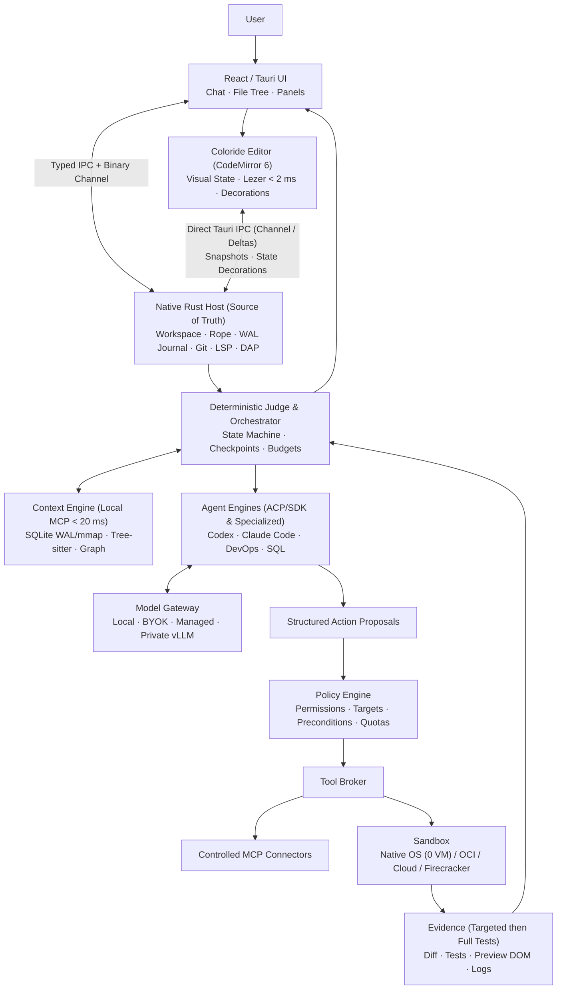

# Coloride — Technical Architecture Blueprint & Development Plan (`EN`)

> 🇫🇷 [Version française complète disponible ici](../fr/ARCHITECTURE_TECHNIQUE.md)

---

## 1. Product Vision & Adaptation to Five Personas

### Executive Summary & Scoping Decisions

**Coloride is a software engineering environment where every AI-proposed action remains subject to deterministic control, isolated execution, and verifiable proofs.**

Confirmed foundational choices:
- **Developer-first MVP**, centered on TypeScript and React.
- **Local/BYOK mode and managed cloud available from the MVP.**
- **macOS, Windows, and Linux supported from the MVP.**
- **Two founders initially**, expanding before the first public release.
- **Editor built on CodeMirror 6 coupled directly to the Native Rust Host (no Monaco)**, integrated into the React/Tauri interface; chat, file tree, and panels remain web-based.
- Full coverage of all five personas in V1.

| Study Proposal | Architectural Decision |
|---|---|
| Rust guarantees < 100 ms startup and < 150 MB RAM | Replace blanket claims with measured targets on the full application with documented hardware and scope. |
| MCP provides isolation and model abstraction | Separate MCP connectors, model adapters, authorization, and execution isolation. MCP organizes tool and resource exchanges. |
| WASM enables lightweight compatibility with VS Code extensions | Combine two tiers: (1) Wasmtime/WASI native plugins and declarative `.vsix` loading (OpenVSX themes, icons, snippets, grammars) in the Rust Host; (2) an isolated **VS Code Extension Host Shim** inside the OS Sandbox translating the `vscode.*` API surface to the Rust Host (`ropey`) and CodeMirror 6 ([LOT-029](./LOTS/LOT-029.md)). |
| Local-first and BYOK eliminate risks and costs | Measure actual data transfers and operating costs; BYOK shifts inference costs to the user without eliminating platform overhead. |

### UX/UI Persona Adaptation Matrix

A single workspace powers three presentations: **Create**, **Learn**, and **Develop**, plus specialized **Infrastructure** and **Data** workspaces:

| Persona | Interface & Flow | Architectural Adaptation | User Control |
|---|---|---|---|
| **General Public / No-Code** | Conversation, visual selection, live preview, clear history, 1-click Publish | React templates & component catalog; visual edits compiled into AST code changes; managed execution & hosting | Validate visual result, inspect cost, roll back to any published version |
| **Junior Developer** | Guided editor with explanations, contextualized diagnostics, step-by-step fixes | LSP for errors; pedagogical micro-agent receiving diagnostic, relevant code, and test results | Understand a fix before applying; progressively reveal diff, terminal, and debugger |
| **Senior Developer** | Coloride editor, full file tree, navigation, multi-file diff, terminal, debugger, task supervision | Project dependency graph, versioned conventions, isolated worktrees, parallel agents | Define scope, budget, autonomy policy, and validation criteria |
| **DevOps Engineer** | Infrastructure plans, pipelines, inventory, incidents, correlated logs | Terraform, Ansible, GitHub Actions, and Kubernetes connectors; temporary identities; separate deployment executor | Inspect target and exact plan before any production change |
| **DBA** | Schemas, SQL, execution plans, performance comparisons, migrations | PostgreSQL connector, statistics, sanitized clones, and migration executor | Read-only access by default; lock timeouts, backups, and destructive change guards |

### Interface Layout: The 4-Zone "Multi-Chat Cockpit"

1. **Far Left — `Activity Bar` (VS Code style):** vertical icon bar switching the sidebar between 💬 Chat Sessions (default), 📁 File Explorer, 🔍 Global Search (SQLite FTS5), 🌿 Git & Checkpoints, 🐛 Debug & Tests, and 🔌 MCP Connectors / Models / Extensions.
2. **Left — Dynamic Sidebar:** displays agent sessions with their status badge (`🟢/🟡/🔴/🟠`) or the file tree annotated by validation state.
3. **Center — Tabbed Main Area & Multi-Chat Grid (1 to 8 concurrent chats):** tab bar with layout selector (`1 | 2 | 4 | 8 chats`). Each active chat runs in its own isolated `git worktree` and displays its real-time Coloride state border.
4. **Right — Contextual Inspector (`[ 👁 Preview | 💻 Code & Diff ]`):** synchronized in `< 10 ms` with the selected chat.

### Coloride Validation States Semantics

| Coloride State | Icon & Label | Exact Condition | User Action / Transition |
|---|---|---|---|
| 🟢 **Green** | `✓ Validated` | Successful build, `vtsls`/Biome 0 errors, 100% impacted tests passing in sandbox, and `Preview Service` 0 runtime errors on the exact revision hash | Ready to merge or publish; transitions immediately to `⟳ Stale Validation` as soon as a single character in the range is edited |
| 🟡 **Yellow / Amber** | `! Needs Review` | Agent-generated patch awaiting human review, architectural decision, or non-blocking warning | Interactive review via `@codemirror/merge` (Accept, Reject, or Request Adjustment) |
| 🔴 **Red** | `✕ Failed` | Compilation error, `vtsls` type error, blocking Biome rule, failed test, or preview runtime crash | Inspect correlated error trace; manual fix or targeted agent retry (max 2 auto retries) |
| 🟠 **Orange / Gray** | `⟳ Stale Validation` | Previously `✓ Validated` range modified locally by the user after tests passed | Automatic incremental background re-verification to restore `✓ Validated` or `✕ Failed` |
| 🔵 **Blue** | `• Unchanged Source` | Original or infrastructure code untouched by the current task | Normal editing; serves as the stable reference baseline |

---

## 2. Global Architecture, Context Engine & Execution

### Core Technical Contracts
See [ARCHITECTURE_MAP.md](./ARCHITECTURE_MAP.md) and [LOT-002](./LOTS/LOT-002.md) for the 9 canonical contracts: `EditorTransaction`, `EditorSnapshot`, `TaskSpec`, `ContextBundle`, `ModelProvider`, `ToolCall`, `ChangeSet`, `Evidence`, `Approval`.

### Progressive Execution Isolation (No Mandatory Docker)
1. **Tier 1 — Default Local (0 VM, < 5 ms):** OS-native kernel sandbox (`sandbox-exec`/Seatbelt on macOS, `Landlock` + `bubblewrap` on Linux, `AppContainer` + `Job Objects` on Windows) over a *Copy-on-Write* `git worktree`. Outbound network and `~/.ssh`/`~/.aws` blocked by default.
2. **Tier 2 — Optional Containerized Local:** Automatic OCI detection (**OrbStack, Docker Desktop, Podman**) with a *Warm Sandbox Pool* and read-only package cache (`pnpm`/`bun`).
3. **Tier 3 — Cloud MVP:** Isolated AWS ECS Fargate task per execution (EU region).
4. **Tier 4 — V1/Enterprise:** Hardened Linux/KVM **Firecracker** microVMs with fast snapshot restore.
5. **Extensions & VS Code Emulator:** **Wasmtime/WASI** native plugins + isolated **VS Code Extension Host Shim** ([LOT-029](./LOTS/LOT-029.md)).

---

## 3. Target Monorepo Structure & Measurable Objectives

See [IMPLEMENTATION_PLAN.md](./IMPLEMENTATION_PLAN.md) for the complete 4-phase roadmap (`M1.1` → `M4.0`), the 29 executable lots, the 7 fluidity levers, and the 19 blocking qualification scenarios.
