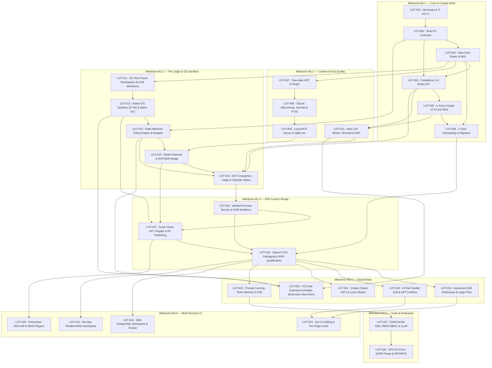

# Coloride — Master Implementation Plan, Sequencing & Traceability (`IMPLEMENTATION_PLAN.md`)

> 🇫🇷 [Version française disponible ici](../fr/IMPLEMENTATION_PLAN.md)
>
> This document governs the progressive delivery of the architecture described in [ARCHITECTURE_TECHNIQUE.md](./ARCHITECTURE_TECHNIQUE.md) and mapped in [ARCHITECTURE_MAP.md](./ARCHITECTURE_MAP.md).
> Every lot listed below has its complete executable specification inside [LOTS/](./LOTS).

---

## 1. Decomposition Strategy & Engineering Principles

The solution is decomposed according to the hierarchy:
**Architecture → 4 Phases (MVP, Beta, V1, Enterprise) → 7 Domains → Crates & Packages → 29 Atomic Lots (`LOT-001` to `LOT-029`) → Technical Tasks → Tests → Acceptance Criteria**.

Principles enforced after the second optimization pass:
1. **Immediate contract decoupling ([LOT-002](./LOTS/LOT-002.md)):** The 9 Rust/TypeScript contracts are auto-generated in Lot 2 so both founders (Frontend/CM6 and Rust/AI) can work in parallel without blocking each other.
2. **Early validation of critical invariants:**
   - UTF-8/UTF-16 offset invariants and crash recovery are verified via *Property-Based Testing* in [LOT-003](./LOTS/LOT-003.md).
   - Keystroke latency `p95 ≤ 16 ms` and immediate local invalidation `🟢 → 🟠` are verified in [LOT-004](./LOTS/LOT-004.md).
   - Secret/ACL filtering is tested in [LOT-008](./LOTS/LOT-008.md) and OS sandbox anti-escape in [LOT-012](./LOTS/LOT-012.md).
3. **Controlled granularity:** Each lot represents **2 to 5 developer-days** (16 h to 40 h), has a single primary responsibility, a verifiable deliverable, and preserves all existing invariants.

---

## 2. Master Table of the 29 Lots

| ID | Status | Detailed Spec | Lot Name | Milestone | Priority | Dependencies | Estimate | Risk | Verifiable Deliverable |
|---|---|---|---|---|---|---|---|---|---|
| **LOT-001** | `🟢 Validated` | [LOT-001.md](./LOTS/LOT-001.md) | Cargo/pnpm Monorepo Foundation, Tauri v2 Shell & 3-OS CI | M1.1 | P0 | None | 2 d (16 h) | Low | Compilable macOS/Win/Linux monorepo + green `ci.yml` |
| **LOT-002** | `🟢 Validated` | [LOT-002.md](./LOTS/LOT-002.md) | Rust Technical Contracts & TypeScript Generation (`protocol-types`) | M1.1 | P0 | LOT-001 | 2 d (16 h) | Low | Rust contracts + drift-free `@coloride/protocol-types` package |
| **LOT-003** | `🔜 Ready` | [LOT-003.md](./LOTS/LOT-003.md) | `ropey` Buffer Engine, WAL Journal & Crash Recovery (`host-core`) | M1.1 | P0 | LOT-002 | 4 d (32 h) | High | Rust `DocumentService` with `ropey`, UTF-8/16 offsets & crash recovery |
| **LOT-004** | `⏳ Planned` | [LOT-004.md](./LOTS/LOT-004.md) | Isolated CodeMirror 6 Editor & Binary IPC Bridge (`editor-cm6`) | M1.1 | P0 | LOT-002, LOT-003 | 4 d (32 h) | High | Binary-synced `@coloride/editor-cm6` (< 16 ms) + Coloride states |
| **LOT-005** | `⏳ Planned` | [LOT-005.md](./LOTS/LOT-005.md) | 4-Zone Cockpit UI Shell, Lazy Boot & Virtualization (`web-ui`) | M1.1 | P0 | LOT-004 | 3.5 d (28 h) | Medium | 4-zone Cockpit UI (*Lazy Boot* ≤ 3 s, inspector switch < 10 ms) |
| **LOT-006** | `⏳ Planned` | [LOT-006.md](./LOTS/LOT-006.md) | 1-Click Onboarding & Migration Service (VS Code / Cursor / Claude) | M1.1 | P1 | LOT-003, LOT-005 | 2.5 d (20 h) | Low | 1-click importer (keymaps, themes, rules, quarantined MCP, `.vsix`) |
| **LOT-007** | `⏳ Planned` | [LOT-007.md](./LOTS/LOT-007.md) | Incremental `Tree-sitter` AST Analysis & Symbol Graph | M1.2 | P0 | LOT-003 | 3.5 d (28 h) | Medium | `Tree-sitter` parser on `ropey` + impact graph + *Test Impact Analysis* |
| **LOT-008** | `⏳ Planned` | [LOT-008.md](./LOTS/LOT-008.md) | SQLite (`WAL`/`mmap`) Context Engine Storage, Secret Filtering & FTS5 | M1.2 | P0 | LOT-007 | 4 d (32 h) | Medium | FTS5 BM25 index (0 MB at boot), unsaved buffer overlay & ACL/secret filter |
| **LOT-009** | `⏳ Planned` | [LOT-009.md](./LOTS/LOT-009.md) | Local MCP Server (< 20 ms) & Optional Embeddings (`sqlite-vec`) | M1.2 | P1 | LOT-008 | 3 d (24 h) | Medium | Local MCP server (< 20 ms) + `ContextBundle` (16k tokens) + `sqlite-vec` |
| **LOT-010** | `⏳ Planned` | [LOT-010.md](./LOTS/LOT-010.md) | Fast Quality Integration (`vtsls` LSP, Biome) & Terminal/DAP | M1.2 | P0 | LOT-004, LOT-005 | 4 d (32 h) | Medium | `vtsls` + Biome projected in CM6 + binary `xterm.js` + DAP + *Workspace Trust* |
| **LOT-011** | `⏳ Planned` | [LOT-011.md](./LOTS/LOT-011.md) | Invisible Git Time-Travel Checkpoints & *Copy-on-Write* Worktrees | M1.3 | P0 | LOT-003 | 3 d (24 h) | Medium | `refs/coloride/checkpoints/*` + 1-click rollback + CoW worktrees |
| **LOT-012** | `⏳ Planned` | [LOT-012.md](./LOTS/LOT-012.md) | 0-VM Native OS Sandbox (Seatbelt, Landlock, AppContainer) & Warm OCI | M1.3 | P0 | LOT-011 | 5 d (40 h) | High | Multi-OS `sandbox-runner` (< 5 ms) *Fail-Closed* + optional OCI pool |
| **LOT-013** | `⏳ Planned` | [LOT-013.md](./LOTS/LOT-013.md) | Task State Machine, Policy Engine, Budgets & Tool Broker | M1.3 | P0 | LOT-002, LOT-012 | 4 d (32 h) | High | Persistent 11-state machine, `Policy Engine`, quotas & `Tool Broker` |
| **LOT-014** | `⏳ Planned` | [LOT-014.md](./LOTS/LOT-014.md) | Model Gateway (Local `llama.cpp`/Ollama, BYOK, Cloud) & ACP/SDK Bridge | M1.3 | P0 | LOT-009, LOT-013 | 4 d (32 h) | Medium | Unified Model Gateway (completion ≤ 700 ms) + ACP bridge (Claude/Codex) |
| **LOT-015** | `⏳ Planned` | [LOT-015.md](./LOTS/LOT-015.md) | AST `ChangeSet` Compiler, Judge Loop & Coloride States (`🟢🟡🔴🟠🔵`) | M1.3 | P0 | LOT-004, LOT-010, LOT-013, LOT-014 | 5 d (40 h) | High | AST compiler + deterministic Judge (max 2 retries) + `@codemirror/merge` |
| **LOT-016** | `⏳ Planned` | [LOT-016.md](./LOTS/LOT-016.md) | Isolated `Preview Service` (Browser Loop) & Runtime `Evidence` Capture | M1.4 | P0 | LOT-015 | 3 d (24 h) | Medium | Isolated preview (0 Tauri IPC access) injecting `console.error`/DOM in `Evidence` |
| **LOT-017** | `⏳ Planned` | [LOT-017.md](./LOTS/LOT-017.md) | Managed Cloud API (Axum/Postgres/OIDC), Fargate Runner & R2/Pages Publishing | M1.4 | P1 | LOT-012, LOT-014, LOT-016 | 4.5 d (36 h) | Medium | Axum API + EU Fargate Runner + Cloudflare R2/Pages digest publishing |
| **LOT-018** | `⏳ Planned` | [LOT-018.md](./LOTS/LOT-018.md) | Signed 3-OS Packaging, Updater, Accessibility & MVP Qualification | M1.4 | P0 | LOT-006, LOT-016, LOT-017 | 3.5 d (28 h) | Medium | Signed 3-OS installers + 19 blocking scenarios + 100-task TS benchmark |
| **LOT-019** | `⏳ Planned` | [LOT-019.md](./LOTS/LOT-019.md) | Advanced CM6 Extensions (Multi-cursor, Folding, Large Files) | M2.0 | P1 | LOT-004, LOT-018 | 3 d (24 h) | Low | Multi-cursor, snippets, AST folding & large file degraded mode |
| **LOT-020** | `⏳ Planned` | [LOT-020.md](./LOTS/LOT-020.md) | Parallel Multi-Chat Grid (8 Concurrent Agents) & AST Conflict Detection | M2.0 | P0 | LOT-011, LOT-015, LOT-018 | 4.5 d (36 h) | High | Up to 8 concurrent chats on isolated worktrees + AST collision detection |
| **LOT-021** | `⏳ Planned` | [LOT-021.md](./LOTS/LOT-021.md) | *Create* Mode (Visual AST Catalog) & *Learn* Mode (Pedagogical Micro-Agent) | M2.0 | P1 | LOT-015, LOT-016, LOT-018 | 4 d (32 h) | Medium | Visual selection compiled to AST + pedagogical micro-agent |
| **LOT-022** | `⏳ Planned` | [LOT-022.md](./LOTS/LOT-022.md) | Prompt Caching, Versioned Team Memory & OpenTelemetry | M2.0 | P1 | LOT-009, LOT-014, LOT-018 | 3 d (24 h) | Low | Tenant-isolated `cache_control` prefixes + governed memory + redacted OTel |
| **LOT-023** | `⏳ Planned` | [LOT-023.md](./LOTS/LOT-023.md) | Real-Time Co-Editing (`y-codemirror.next` / Yjs) & Per-Origin Isolated Undo | M3.0 | P1 | LOT-019, LOT-020 | 4.5 d (36 h) | High | Convergent Yjs/`yrs` CRDT co-editing + origin-isolated `UndoManager` |
| **LOT-024** | `⏳ Planned` | [LOT-024.md](./LOTS/LOT-024.md) | DBA Workspace: PostgreSQL Connector, Sanitized Clones & Migrations | M3.0 | P1 | LOT-013, LOT-018 | 4.5 d (36 h) | High | Read-only default PostgreSQL, `EXPLAIN ANALYZE` on clone, controlled migrations |
| **LOT-025** | `⏳ Planned` | [LOT-025.md](./LOTS/LOT-025.md) | DevOps Workspace: Terraform/Ansible/CI/K8s Connectors & Plan Executor | M3.0 | P1 | LOT-013, LOT-018 | 4.5 d (36 h) | High | Encrypted/redacted Terraform plans + read-only K8s + separate approved executor |
| **LOT-026** | `⏳ Planned` | [LOT-026.md](./LOTS/LOT-026.md) | Firecracker MicroVM Backend & Wasmtime/WASI Extension Isolation | M3.0 | P2 | LOT-012, LOT-017 | 4 d (32 h) | High | Fast-snapshot Linux/KVM Firecracker runner + WASI plugin host |
| **LOT-027** | `⏳ Planned` | [LOT-027.md](./LOTS/LOT-027.md) | Enterprise Governance: SSO (OIDC/SAML/SCIM), RBAC/ABAC & Private vLLM | M4.0 | P2 | LOT-014, LOT-017, LOT-022 | 5 d (40 h) | Medium | SAML/SCIM SSO, central RBAC/ABAC policies, audit & private vLLM endpoints |
| **LOT-028** | `⏳ Planned` | [LOT-028.md](./LOTS/LOT-028.md) | Private VPC/On-Prem Deployment, GDPR Cascading Purge & RPO/RTO Drills | M4.0 | P2 | LOT-027 | 4 d (32 h) | Medium | VPC/On-Prem deployment, cascading GDPR purge & RPO ≤ 15m / RTO ≤ 4h drill |
| **LOT-029** | `⏳ Planned` | [LOT-029.md](./LOTS/LOT-029.md) | VS Code Extension Emulator (`VS Code Extension Host Shim` & OpenVSX `.vsix`) | M2.0 / M3.0 | P1 | LOT-004, LOT-006, LOT-010, LOT-012, LOT-013 | 5 d (40 h) | High | OS-sandboxed Extension Host translating `vscode.*` API to `ropey` & CM6 |

---

## 3. Dependency Graph & Critical Path

---

## 4. Recommended Execution Waves

| Wave | Milestone | Stream A (Product / Frontend / CM6 Founder) | Stream B (Rust / Host / AI / Sandbox Founder) | Quality Gate |
|---|---|---|---|---|
| **Wave 1** | M1.1 | Co-setup [LOT-001](./LOTS/LOT-001.md) + TS contract review [LOT-002](./LOTS/LOT-002.md) | [LOT-001](./LOTS/LOT-001.md) (Cargo workspace/CI) → [LOT-002](./LOTS/LOT-002.md) (Rust contracts) | Green 3-OS CI build + generated `protocol-types` |
| **Wave 2** | M1.1 / M1.2 | [LOT-004](./LOTS/LOT-004.md) (Isolated CodeMirror 6, Lezer < 2 ms, binary IPC, IME) | [LOT-003](./LOTS/LOT-003.md) (`ropey` + WAL + crash recovery) → [LOT-007](./LOTS/LOT-007.md) (`Tree-sitter`) | 100% UTF-8/16 `proptest` + typing p95 ≤ 16 ms |
| **Wave 3** | M1.1 / M1.2 | [LOT-005](./LOTS/LOT-005.md) (4-zone Cockpit, *Lazy Boot* ≤ 3 s) → [LOT-006](./LOTS/LOT-006.md) (1-click Migration) | [LOT-008](./LOTS/LOT-008.md) (SQLite WAL/mmap + FTS5 + secrets) → [LOT-009](./LOTS/LOT-009.md) (MCP < 20 ms) | **Gate M1.1 passed** + local MCP < 20 ms |
| **Wave 4** | M1.2 / M1.3 | [LOT-010](./LOTS/LOT-010.md) (`vtsls` LSP, Biome, binary `xterm.js`, DAP, *Workspace Trust*) | [LOT-011](./LOTS/LOT-011.md) (Git checkpoints & CoW worktrees) → [LOT-012](./LOTS/LOT-012.md) (OS Sandbox < 5 ms) | **Gate M1.2 passed** + 100% sandbox escapes blocked |
| **Wave 5** | M1.3 | UI budgets, permissions, BYOK keyring & Merge View preparation | [LOT-013](./LOTS/LOT-013.md) (State machine, `Policy Engine`, budgets) → [LOT-014](./LOTS/LOT-014.md) (Model Gateway & ACP) | Privacy circuit breaker + completion ≤ 700 ms |
| **Wave 6** | M1.3 / M1.4 | Co-delivery [LOT-015](./LOTS/LOT-015.md) (`@codemirror/merge` & badges) → [LOT-016](./LOTS/LOT-016.md) (`Preview Service`) | [LOT-015](./LOTS/LOT-015.md) (AST `ChangeSet` compiler, Judge loop, max 2 retries) | **Gate M1.3 passed** + `Evidence` with DOM/runtime |
| **Wave 7** | M1.4 | 1-click Publish UI + [LOT-018](./LOTS/LOT-018.md) (Signed 3-OS packaging, accessibility, qualification) | [LOT-017](./LOTS/LOT-017.md) (Axum Cloud API, Fargate, Cloudflare R2/Pages by digest) | **Gate M1.4 (MVP Alpha)**: 19 blocking scenarios + ≥ 70% on 100 TS tasks |
| **Wave 8** | M2.0 | [LOT-019](./LOTS/LOT-019.md) (Advanced CM6) + [LOT-021](./LOTS/LOT-021.md) (*Create* & *Learn* modes) | [LOT-020](./LOTS/LOT-020.md) (8-chat grid & AST conflicts) + [LOT-022](./LOTS/LOT-022.md) (Prompt Caching & OTel) + [LOT-029](./LOTS/LOT-029.md) (VS Code Extension Emulator) | **Gate M2.0 (Closed Beta)**: 8 parallel chats + sandboxed `.vsix` extensions |
| **Wave 9** | M3.0 | [LOT-023](./LOTS/LOT-023.md) (Yjs co-editing & isolated Undo) + DBA/DevOps UI | [LOT-024](./LOTS/LOT-024.md) (Postgres DBA) + [LOT-025](./LOTS/LOT-025.md) (Terraform/K8s DevOps) + [LOT-026](./LOTS/LOT-026.md) (Firecracker/WASI) | **Gate M3.0 (Public V1)**: 5 personas + Yjs convergence |
| **Wave 10** | M4.0 | Enterprise admin console & audit dashboards | [LOT-027](./LOTS/LOT-027.md) (SAML/SCIM SSO, RBAC/ABAC, vLLM) → [LOT-028](./LOTS/LOT-028.md) (VPC/On-Prem, GDPR, RPO/RTO) | **Gate M4.0 (Enterprise)**: GDPR purge + RPO ≤ 15m / RTO ≤ 4h |
