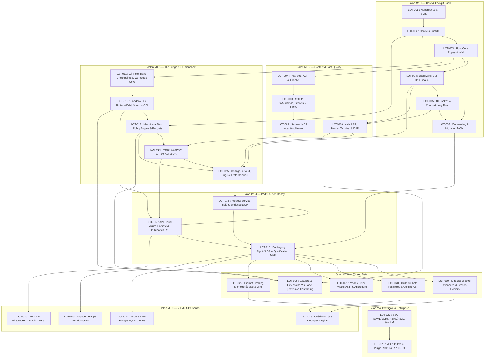

# Coloride — Plan Directeur d'Implémentation, Ordonnancement et Traçabilité (`IMPLEMENTATION_PLAN.md`)

> Ce document gouverne l'exécution progressive de l'architecture décrite dans [ARCHITECTURE_TECHNIQUE.md](./ARCHITECTURE_TECHNIQUE.md) et cartographiée dans [ARCHITECTURE_MAP.md](./ARCHITECTURE_MAP.md).
> Chaque lot listé ci-dessous possède sa spécification exécutable complète dans le répertoire [LOTS/](./LOTS).

---

## 1. Stratégie de Découpage et Principes d'Ingénierie

La solution est découpée selon la hiérarchie :
**Architecture → 4 Phases (MVP, Bêta, V1, Enterprise) → 7 Domaines → Crates & Packages → 28 Lots Atomiques (`LOT-001` à `LOT-028`) → Tâches techniques → Tests → Critères d'acceptation**.

Principes appliqués après la seconde passe d'optimisation :
1. **Découplage immédiat par les contrats ([LOT-002](./LOTS/LOT-002.md)) :** Les 9 contrats Rust/TypeScript sont générés automatiquement dès le 2e lot pour permettre aux deux fondateurs (Frontend/CM6 et Rust/IA) de travailler en parallèle sans blocage.
2. **Validation précoce des invariants critiques :**
   - Les invariants d'offsets UTF-8/UTF-16 et de récupération après crash sont validés par *Property-Based Testing* dès [LOT-003](./LOTS/LOT-003.md).
   - La latence de frappe `p95 ≤ 16 ms` et l'invalidation locale `🟢 → 🟠` sont vérifiées dès [LOT-004](./LOTS/LOT-004.md).
   - Le filtrage des secrets/ACL est testé dès [LOT-008](./LOTS/LOT-008.md) et l'anti-évasion de sandbox OS dès [LOT-012](./LOTS/LOT-012.md).
3. **Granularité maîtrisée :** Chaque lot représente entre **2 et 5 jours-développeur** (16 h à 40 h), possède une responsabilité unique, un livrable vérifiable et ne dégrade aucun invariant existant.

---

## 2. Tableau Directeur des 29 Lots

| ID | Statut | Fiche détaillée | Nom du lot | Jalon | Priorité | Dépendances | Estimation | Risque | Livrable vérifiable |
|---|---|---|---|---|---|---|---|---|---|
| **LOT-001** | `🟢 Validé` | [LOT-001.md](./LOTS/LOT-001.md) | Socle Monorepo Cargo/pnpm, Shell Tauri v2 & CI 3 OS | M1.1 | P0 | Aucune | 2 j (16 h) | Faible | Monorepo compilable macOS/Win/Linux + pipeline `ci.yml` vert |
| **LOT-002** | `🟢 Validé` | [LOT-002.md](./LOTS/LOT-002.md) | Contrats techniques Rust & Génération TypeScript (`protocol-types`) | M1.1 | P0 | LOT-001 | 2 j (16 h) | Faible | Contrats Rust + package `@coloride/protocol-types` généré sans dérive |
| **LOT-003** | `🔜 Prêt` | [LOT-003.md](./LOTS/LOT-003.md) | Moteur de buffers `ropey`, Journal WAL & Crash Recovery (`host-core`) | M1.1 | P0 | LOT-002 | 4 j (32 h) | Élevé | `DocumentService` Rust avec `ropey`, offsets UTF-8/16 et reprise sur crash |
| **LOT-004** | `⏳ Planifié` | [LOT-004.md](./LOTS/LOT-004.md) | Éditeur CodeMirror 6 isolé & Pont IPC binaire (`editor-cm6`) | M1.1 | P0 | LOT-002, LOT-003 | 4 j (32 h) | Élevé | `@coloride/editor-cm6` synchronisé en binaire (< 16 ms) + états Coloride |
| **LOT-005** | `⏳ Planifié` | [LOT-005.md](./LOTS/LOT-005.md) | Shell UI Cockpit 4 zones, Lazy Boot & Virtualisation (`web-ui`) | M1.1 | P0 | LOT-004 | 3,5 j (28 h) | Moyen | Interface Cockpit 4 zones (*Lazy Boot* ≤ 3 s, bascule inspecteur < 10 ms) |
| **LOT-006** | `⏳ Planifié` | [LOT-006.md](./LOTS/LOT-006.md) | Service d'Onboarding & Migration 1-clic (VS Code / Cursor / Claude) | M1.1 | P1 | LOT-003, LOT-005 | 2,5 j (20 h) | Faible | Importateur 1-clic (keymaps, thèmes, règles, MCP en quarantaine, `.vsix`) |
| **LOT-007** | `⏳ Planifié` | [LOT-007.md](./LOTS/LOT-007.md) | Analyse AST incrémentale `Tree-sitter` & Graphe de symboles | M1.2 | P0 | LOT-003 | 3,5 j (28 h) | Moyen | Parseur `Tree-sitter` sur `ropey` + graphe d'impact + *Test Impact Analysis* |
| **LOT-008** | `⏳ Planifié` | [LOT-008.md](./LOTS/LOT-008.md) | Stockage Context Engine SQLite (`WAL`/`mmap`), Filtrage Secrets & FTS5 | M1.2 | P0 | LOT-007 | 4 j (32 h) | Moyen | Index FTS5 BM25 (0 Mo au boot), priorité buffers et filtre ACL/secrets |
| **LOT-009** | `⏳ Planifié` | [LOT-009.md](./LOTS/LOT-009.md) | Serveur MCP Local (< 20 ms) & Embeddings optionnels (`sqlite-vec`) | M1.2 | P1 | LOT-008 | 3 j (24 h) | Moyen | Serveur MCP local (< 20 ms) + `ContextBundle` (16k tokens) + `sqlite-vec` |
| **LOT-010** | `⏳ Planifié` | [LOT-010.md](./LOTS/LOT-010.md) | Intégration Qualité Rapide (`vtsls` LSP, Biome) & Terminal/DAP | M1.2 | P0 | LOT-004, LOT-005 | 4 j (32 h) | Moyen | `vtsls` + Biome projetés dans CM6 + `xterm.js` binaire + DAP + *Workspace Trust* |
| **LOT-011** | `⏳ Planifié` | [LOT-011.md](./LOTS/LOT-011.md) | Git Time-Travel Checkpoints invisibles & Worktrees *Copy-on-Write* | M1.3 | P0 | LOT-003 | 3 j (24 h) | Moyen | Checkpoints `refs/coloride/checkpoints/*` + rollback 1-clic + worktrees CoW |
| **LOT-012** | `⏳ Planifié` | [LOT-012.md](./LOTS/LOT-012.md) | Sandbox OS Native 0-VM (Seatbelt, Landlock, AppContainer) & Warm OCI | M1.3 | P0 | LOT-011 | 5 j (40 h) | Élevé | `sandbox-runner` multi-OS (< 5 ms) *Fail-Closed* + pool OCI optionnel |
| **LOT-013** | `⏳ Planifié` | [LOT-013.md](./LOTS/LOT-013.md) | Machine à états de Tâche, Policy Engine, Budgets & Tool Broker | M1.3 | P0 | LOT-002, LOT-012 | 4 j (32 h) | Élevé | Machine à 11 états persistante, `Policy Engine`, quotas et `Tool Broker` |
| **LOT-014** | `⏳ Planifié` | [LOT-014.md](./LOTS/LOT-014.md) | Model Gateway (Local `llama.cpp`/Ollama, BYOK, Cloud) & Pont ACP/SDK | M1.3 | P0 | LOT-009, LOT-013 | 4 j (32 h) | Moyen | Passerelle modèles unifiée (complétion ≤ 700 ms) + pont ACP (Claude/Codex) |
| **LOT-015** | `⏳ Planifié` | [LOT-015.md](./LOTS/LOT-015.md) | Compilateur `ChangeSet` AST, Boucle du Juge & États Coloride (`🟢🟡🔴🟠🔵`) | M1.3 | P0 | LOT-004, LOT-010, LOT-013, LOT-014 | 5 j (40 h) | Élevé | Compilateur AST + Juge déterministe (max 2 retries) + `@codemirror/merge` |
| **LOT-016** | `⏳ Planifié` | [LOT-016.md](./LOTS/LOT-016.md) | `Preview Service` isolé (Browser Loop) & Capture d'`Evidence` runtime | M1.4 | P0 | LOT-015 | 3 j (24 h) | Moyen | Aperçu isolé (0 accès Tauri IPC) injectant `console.error`/DOM dans `Evidence` |
| **LOT-017** | `⏳ Planifié` | [LOT-017.md](./LOTS/LOT-017.md) | API Cloud Managée (Axum/Postgres/OIDC), Runner Fargate & Publication R2/Pages | M1.4 | P1 | LOT-012, LOT-014, LOT-016 | 4,5 j (36 h) | Moyen | API Axum + Runner Fargate UE + Publication Cloudflare R2/Pages par digest |
| **LOT-018** | `⏳ Planifié` | [LOT-018.md](./LOTS/LOT-018.md) | Packaging Signé 3 OS, Updater, Accessibilité & Qualification MVP | M1.4 | P0 | LOT-006, LOT-016, LOT-017 | 3,5 j (28 h) | Moyen | Binaires signés 3 OS + 19 scénarios bloquants + benchmark 100 tâches TS |
| **LOT-019** | `⏳ Planifié` | [LOT-019.md](./LOTS/LOT-019.md) | Extensions CM6 avancées (Multicurseur, Pliage, Grands Fichiers) | M2.0 | P1 | LOT-004, LOT-018 | 3 j (24 h) | Faible | Multicurseur, snippets, pliage AST et mode dégradé grands fichiers |
| **LOT-020** | `⏳ Planifié` | [LOT-020.md](./LOTS/LOT-020.md) | Grille Multi-Chat Parallèle (8 agents //) & Détection de conflits AST | M2.0 | P0 | LOT-011, LOT-015, LOT-018 | 4,5 j (36 h) | Élevé | Jusqu'à 8 chats simultanés sur worktrees isolés + détection collisions AST |
| **LOT-021** | `⏳ Planifié` | [LOT-021.md](./LOTS/LOT-021.md) | Modes *Créer* (Catalogue Visuel AST) & *Apprendre* (Micro-Agent Pédagogique) | M2.0 | P1 | LOT-015, LOT-016, LOT-018 | 4 j (32 h) | Moyen | Sélection visuelle traduite en AST + micro-agent pédagogique |
| **LOT-022** | `⏳ Planifié` | [LOT-022.md](./LOTS/LOT-022.md) | Prompt Caching, Mémoire d'Équipe versionnée & Télémétrie OpenTelemetry | M2.0 | P1 | LOT-009, LOT-014, LOT-018 | 3 j (24 h) | Faible | Préfixes `cache_control` isolés par tenant + mémoire gouvernée + OTel expurgé |
| **LOT-023** | `⏳ Planifié` | [LOT-023.md](./LOTS/LOT-023.md) | Coédition Temps Réel (`y-codemirror.next` / Yjs) & Undo isolé par origine | M3.0 | P1 | LOT-019, LOT-020 | 4,5 j (36 h) | Élevé | Coédition CRDT Yjs/`yrs` convergente + `UndoManager` isolé par origine |
| **LOT-024** | `⏳ Planifié` | [LOT-024.md](./LOTS/LOT-024.md) | Espace DBA : Connecteur PostgreSQL, Clones Assainis & Migrations | M3.0 | P1 | LOT-013, LOT-018 | 4,5 j (36 h) | Élevé | PostgreSQL lecture par défaut, `EXPLAIN ANALYZE` sur clone, migrations contrôlées |
| **LOT-025** | `⏳ Planifié` | [LOT-025.md](./LOTS/LOT-025.md) | Espace DevOps : Connecteurs Terraform/Ansible/CI/K8s & Exécuteur de plans | M3.0 | P1 | LOT-013, LOT-018 | 4,5 j (36 h) | Élevé | Plans Terraform chiffrés/masqués + K8s lecture + exécuteur séparé approuvé |
| **LOT-026** | `⏳ Planifié` | [LOT-026.md](./LOTS/LOT-026.md) | Backend MicroVM Firecracker & Isolation d'extensions Wasmtime/WASI | M3.0 | P2 | LOT-012, LOT-017 | 4 j (32 h) | Élevé | Runner Firecracker Linux/KVM à snapshots rapides + hôte plugins WASI |
| **LOT-027** | `⏳ Planifié` | [LOT-027.md](./LOTS/LOT-027.md) | Gouvernance Enterprise : SSO (OIDC/SAML/SCIM), RBAC/ABAC & vLLM Privé | M4.0 | P2 | LOT-014, LOT-017, LOT-022 | 5 j (40 h) | Moyen | SSO SAML/SCIM, politiques centrales RBAC/ABAC, audit et endpoints vLLM |
| **LOT-028** | `⏳ Planifié` | [LOT-028.md](./LOTS/LOT-028.md) | Déploiement Privé VPC/On-Prem, Conformité RGPD (Purge) & Exercices RPO/RTO | M4.0 | P2 | LOT-027 | 4 j (32 h) | Moyen | Déploiement VPC/On-Prem, purge RGPD en cascade et exercice RPO ≤ 15m / RTO ≤ 4h |
| **LOT-029** | `⏳ Planifié` | [LOT-029.md](./LOTS/LOT-029.md) | Émulateur d'Extensions VS Code (`VS Code Extension Host Shim` & OpenVSX `.vsix`) | M2.0 / M3.0 | P1 | LOT-004, LOT-006, LOT-010, LOT-012, LOT-013 | 5 j (40 h) | Élevé | Extension Host isolé en Sandbox OS traduisant l'API `vscode.*` vers `ropey` & CM6 |

---

## 3. Graphe de Dépendances et Chemin Critique

- **Chemin critique du MVP :** `LOT-001 → LOT-002 → LOT-003 → LOT-011 → LOT-012 → LOT-013 → LOT-014 → LOT-015 → LOT-016 → LOT-017 → LOT-018` (40 jours-développeur sur l'axe critique, ramenés à ~8 semaines calendaires en binôme grâce au parallélisme Front/Rust).

---

## 4. Plan d'Exécution Recommandé par Vagues

| Vague | Jalon | Flux A (Fondateur Produit / Frontend / CM6) | Flux B (Fondateur Rust / Host / IA / Sandbox) | Condition de passage (Gate) |
|---|---|---|---|---|
| **Vague 1** | M1.1 | Co-setup [LOT-001](./LOTS/LOT-001.md) + validation contrats TS [LOT-002](./LOTS/LOT-002.md) | [LOT-001](./LOTS/LOT-001.md) (Cargo workspace/CI) → [LOT-002](./LOTS/LOT-002.md) (Contrats Rust) | Build CI 3 OS vert + `protocol-types` généré |
| **Vague 2** | M1.1 / M1.2 | [LOT-004](./LOTS/LOT-004.md) (CodeMirror 6 isolé, Lezer < 2 ms, IPC binaire, IME) | [LOT-003](./LOTS/LOT-003.md) (`ropey` + WAL + crash recovery) → [LOT-007](./LOTS/LOT-007.md) (`Tree-sitter`) | `proptest` UTF-8/16 à 100 % + frappe p95 ≤ 16 ms |
| **Vague 3** | M1.1 / M1.2 | [LOT-005](./LOTS/LOT-005.md) (Cockpit 4 zones, *Lazy Boot* ≤ 3 s) → [LOT-006](./LOTS/LOT-006.md) (Migration 1-clic) | [LOT-008](./LOTS/LOT-008.md) (SQLite WAL/mmap + FTS5 + secrets) → [LOT-009](./LOTS/LOT-009.md) (MCP < 20 ms) | **Gate M1.1 validé** + MCP local < 20 ms |
| **Vague 4** | M1.2 / M1.3 | [LOT-010](./LOTS/LOT-010.md) (`vtsls` LSP, Biome, `xterm.js` binaire, DAP, *Workspace Trust*) | [LOT-011](./LOTS/LOT-011.md) (Checkpoints Git & worktrees CoW) → [LOT-012](./LOTS/LOT-012.md) (Sandbox OS < 5 ms) | **Gate M1.2 validé** + 100 % évasions sandbox bloquées |
| **Vague 5** | M1.3 | UI budgets, permissions, coffre BYOK et préparation Merge View | [LOT-013](./LOTS/LOT-013.md) (Machine à états, `Policy Engine`, budgets) → [LOT-014](./LOTS/LOT-014.md) (Model Gateway & ACP) | Coupe-circuit confidentialité + complétion ≤ 700 ms |
| **Vague 6** | M1.3 / M1.4 | Co-réalisation [LOT-015](./LOTS/LOT-015.md) (`@codemirror/merge` & badges) → [LOT-016](./LOTS/LOT-016.md) (`Preview Service`) | [LOT-015](./LOTS/LOT-015.md) (Compilateur `ChangeSet` AST, boucle du Juge, max 2 retries) | **Gate M1.3 validé** + `Evidence` incluant DOM/runtime |
| **Vague 7** | M1.4 | UI Publication 1-clic + [LOT-018](./LOTS/LOT-018.md) (Packaging signé 3 OS, accessibilité, qualification) | [LOT-017](./LOTS/LOT-017.md) (API Cloud Axum, Fargate, Cloudflare R2/Pages par digest) | **Gate M1.4 (MVP Alpha)** : 19 scénarios bloquants + ≥ 70 % sur 100 tâches TS |
| **Vague 8** | M2.0 | [LOT-019](./LOTS/LOT-019.md) (CM6 avancé) + [LOT-021](./LOTS/LOT-021.md) (Modes *Créer* & *Apprendre*) | [LOT-020](./LOTS/LOT-020.md) (Grille 8 chats // & conflits AST) + [LOT-022](./LOTS/LOT-022.md) (Prompt Caching & OTel) + [LOT-029](./LOTS/LOT-029.md) (Émulateur Extensions VS Code) | **Gate M2.0 (Bêta Fermée)** : 8 chats // + Extensions `.vsix` sandboxées |
| **Vague 9** | M3.0 | [LOT-023](./LOTS/LOT-023.md) (Coédition Yjs & Undo isolé) + UI Espaces DBA/DevOps | [LOT-024](./LOTS/LOT-024.md) (DBA Postgres) + [LOT-025](./LOTS/LOT-025.md) (DevOps Terraform/K8s) + [LOT-026](./LOTS/LOT-026.md) (Firecracker/WASI) | **Gate M3.0 (V1 Publique)** : 5 personas + convergence Yjs |
| **Vague 10** | M4.0 | Console d'administration Enterprise & tableaux de bord d'audit | [LOT-027](./LOTS/LOT-027.md) (SSO SAML/SCIM, RBAC/ABAC, vLLM) → [LOT-028](./LOTS/LOT-028.md) (VPC/On-Prem, RGPD, RPO/RTO) | **Gate M4.0 (Enterprise)** : Purge RGPD + RPO ≤ 15m / RTO ≤ 4h |

---

## 5. Matrice de Traçabilité (Exigences → Lots → Scénarios de Validation)

| Scénario bloquant (Section 5 de `ARCHITECTURE_TECHNIQUE.md`) | Lot(s) d'implémentation | Lot de qualification finale | Niveau de test |
|---|---|---|---|
| 1. Édition TS avec chat en streaming, terminal et grand arbre (p95 ≤ 16 ms, 0 remontage) | [LOT-004](./LOTS/LOT-004.md), [LOT-005](./LOTS/LOT-005.md), [LOT-010](./LOTS/LOT-010.md) | [LOT-018](./LOTS/LOT-018.md) | Intégration + Perf E2E |
| 2. Synchronisation CodeMirror 6 ↔ Host Rust sur texte Unicode et IME | [LOT-003](./LOTS/LOT-003.md), [LOT-004](./LOTS/LOT-004.md) | [LOT-018](./LOTS/LOT-018.md) | `proptest` + Intégration IPC |
| 3. Navigation clavier, zoom, VoiceOver, NVDA et Orca sur les 3 OS | [LOT-004](./LOTS/LOT-004.md), [LOT-005](./LOTS/LOT-005.md) | [LOT-018](./LOTS/LOT-018.md) | E2E + Validation humaine |
| 4. Bascule rapide entre fichiers avec lectures ou événements IPC retardés | [LOT-003](./LOTS/LOT-003.md), [LOT-004](./LOTS/LOT-004.md) | [LOT-018](./LOTS/LOT-018.md) | Intégration IPC |
| 5. Crash de la WebView ou du host, sauvegarde pendant une nouvelle édition | [LOT-003](./LOTS/LOT-003.md), [LOT-004](./LOTS/LOT-004.md) | [LOT-018](./LOTS/LOT-018.md) | `proptest` + Crash test |
| 6. Patch IA, diff ou diagnostic reçu après une modification locale | [LOT-010](./LOTS/LOT-010.md), [LOT-015](./LOTS/LOT-015.md) | [LOT-018](./LOTS/LOT-018.md) | Intégration Juge |
| 7. Coloration syntaxique et états de validation (`🟢 → 🟠` immédiat dès modification locale) | [LOT-004](./LOTS/LOT-004.md), [LOT-015](./LOTS/LOT-015.md) | [LOT-018](./LOTS/LOT-018.md) | Composant + E2E 3 OS |
| 8. Coédition V1 (`y-codemirror.next`), reconnexion et undo local après modifications distantes | [LOT-023](./LOTS/LOT-023.md) | [LOT-023](./LOTS/LOT-023.md) | Intégration CRDT |
| 9. L'utilisateur modifie un fichier pendant une tâche (conflit présenté, 0 écrasement) | [LOT-011](./LOTS/LOT-011.md), [LOT-015](./LOTS/LOT-015.md), [LOT-020](./LOTS/LOT-020.md) | [LOT-018](./LOTS/LOT-018.md) | Intégration Git/Juge |
| 10. Crash après une action externe (`NeedsReconciliation`, absence de duplication aveugle) | [LOT-013](./LOTS/LOT-013.md) | [LOT-018](./LOTS/LOT-018.md) | Unitaire + Intégration |
| 11. Prompt injection dans un fichier ou une réponse MCP (0 élévation de privilèges) | [LOT-006](./LOTS/LOT-006.md), [LOT-008](./LOTS/LOT-008.md), [LOT-013](./LOTS/LOT-013.md) | [LOT-018](./LOTS/LOT-018.md) | Sécurité |
| 12. Accès par symlink, socket, métadonnées cloud ou chemin détourné (refus + audit) | [LOT-012](./LOTS/LOT-012.md), [LOT-017](./LOTS/LOT-017.md) | [LOT-018](./LOTS/LOT-018.md) | Sécurité Sandbox 3 OS |
| 13. Annulation, fork bomb, disque ou logs saturés (arrêt borné et nettoyage) | [LOT-012](./LOTS/LOT-012.md), [LOT-013](./LOTS/LOT-013.md) | [LOT-018](./LOTS/LOT-018.md) | Sécurité & Robustesse |
| 14. Aperçu généré malveillant (0 accès au pont Tauri, aux credentials ou à l'origine de contrôle) | [LOT-016](./LOTS/LOT-016.md) | [LOT-018](./LOTS/LOT-018.md) | Sécurité WebView |
| 15. Coupure réseau ou panne fournisseur (état conservé, 0 bascule de confidentialité implicite) | [LOT-014](./LOTS/LOT-014.md), [LOT-017](./LOTS/LOT-017.md) | [LOT-018](./LOTS/LOT-018.md) | Intégration Réseau |
| 16. Modification après tests réussis (validation marquée périmée `🟠`) | [LOT-004](./LOTS/LOT-004.md), [LOT-015](./LOTS/LOT-015.md) | [LOT-018](./LOTS/LOT-018.md) | Unitaire + E2E |
| 17. Migration SQL interrompue (état inspecté, reprise contrôlée ou restauration) | [LOT-024](./LOTS/LOT-024.md) | [LOT-024](./LOTS/LOT-024.md) | Intégration PostgreSQL |
| 18. Publication puis restauration (promotion et retour vers des artefacts vérifiés par digest) | [LOT-017](./LOTS/LOT-017.md) | [LOT-018](./LOTS/LOT-018.md) | Intégration Cloud |
| 19. Mise à jour desktop (installation signée, migration de données et récupération sur 3 OS) | [LOT-018](./LOTS/LOT-018.md) | [LOT-018](./LOTS/LOT-018.md) | E2E Natif 3 OS |
